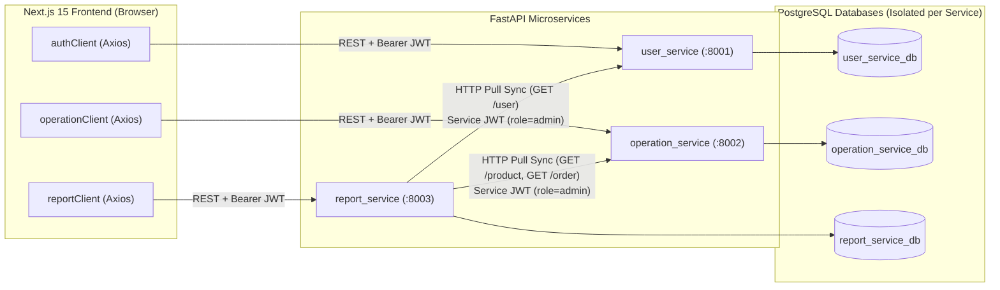
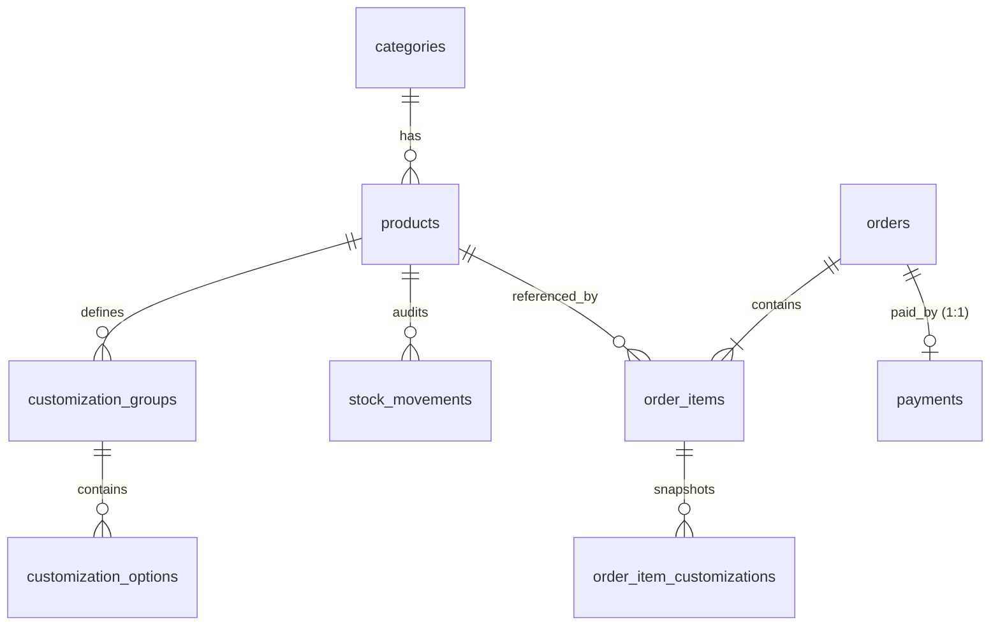

# Step 1: Project Discovery & Current Architecture (`docs/01_ARCHITECTURE.md`)

> **Frontend Router Framework Confirmation**: The frontend (`coffee_shop_frontend`) uses **Next.js 15 (`^15.5.22`) with the App Router** (`src/app/layout.tsx`, route groups `src/app/(auth)/*` and `src/app/(dashboard)/*`, and Edge middleware `src/middleware.ts`). There is no `pages/` directory.

---

## 1. Repository & Workspace Structure

The workspace (`D:\Study\Year-4\Python`) is organized into three top-level project directories:

```text
D:\Study\Year-4\Python\
├── coffee_shop/                     # Backend monorepo (FastAPI microservices, Git repo)
│   ├── .github/workflows/ci.yml     # GitHub Actions CI pipeline
│   ├── libs/testing/                # Shared pytest helper package (coffee_testing)
│   ├── scripts/                     # Integration & mock-pattern verification scripts
│   ├── tests/                       # Cross-service integration test suite
│   ├── user_service/                # Auth & User Management microservice (Port 8001)
│   ├── operation_service/           # Catalog, Stock, Order & Payment microservice (Port 8002)
│   └── report_service/              # Read-model Analytics & Sync microservice (Port 8003)
├── coffee_shop_frontend/            # Next.js 15 (App Router) + React 19 + TypeScript frontend
│   └── src/
│       ├── app/                     # App Router layouts & pages ((auth) and (dashboard))
│       ├── components/              # Shared UI primitives (Radix UI + Tailwind v4) & layout
│       ├── config/                  # Zod-validated env.ts & TanStack Query client
│       ├── constants/               # Routes, roles, auth cookie constants, queryKeys
│       ├── features/                # Domain modules: auth, cart, category, dashboard, order, payment, product, user
│       ├── hooks/                   # Custom hooks (useDebounce, useMediaQuery, usePagination, useToast)
│       ├── lib/                     # apiResponse unwrapper, decimal parser, cn utility
│       ├── services/                # Axios instances (authClient, operationClient, reportClient) & interceptors
│       ├── store/                   # Zustand stores (authStore, cartStore, toastStore, uiStore)
│       ├── types/                   # Shared API envelope & domain enum types
│       └── utils/                   # Currency & date formatters
└── APIM-setup/                      # Gravitee API Management certificate artifact (python-lap.pem)
```

---

## 2. Microservices Inventory & Responsibilities

Each backend service follows a layered Clean Architecture (`api/` → `services/` → `repository/` → `models/`, plus `schemas/`, `core/`, and `dependencies/`) and wraps responses in a uniform JSON envelope:

```json
{
  "success": true,
  "error_code": null,
  "message": "Human-readable status",
  "data": {}
}
```

| Service | Default Port | Database | Core Responsibility | Key Endpoints |
| :--- | :--- | :--- | :--- | :--- |
| **`user_service`** | `8001` | `user_service_db` (PostgreSQL) | User registration, bcrypt password hashing, stateless JWT issuance (`HS256`), profile & RBAC role management (`customer`, `staff`, `admin`), user soft-deletion. | `POST /user`, `POST /user/login`, `GET /user/me`, `GET /user`, `GET/PUT/DELETE /user/{id}`, `PATCH /user/{id}/role`, `PATCH /user/{id}/password` |
| **`operation_service`** | `8002` | `operation_service_db` (PostgreSQL) | Product categories, menu products, product customization groups/options, transactional stock ledger (`stock_movements`), customer/staff orders, and order payment processing. | `CRUD /category`, `CRUD /product`, `POST /product/{id}/stock`, `POST/GET /order`, `GET /order/{id}`, `PATCH /order/{id}/status`, `POST /order/{id}/cancel`, `POST/GET /order/{order_id}/payment` |
| **`report_service`** | `8003` | `report_service_db` (PostgreSQL) | Denormalized read-replica snapshots (`users_snapshot`, `products_snapshot`, `orders_snapshot`, `order_items_snapshot`) and analytics queries (sales summary, daily sales, top products, low stock, user summary). | `POST /report/sync`, `GET /report/sales-summary`, `GET /report/daily-sales`, `GET /report/top-products`, `GET /report/low-stock`, `GET /report/users-summary` |
| **`coffee_shop_frontend`** | `3000` | Browser `localStorage` + Cookie | Operations console & customer ordering portal built on Next.js 15 App Router, TanStack Query v5, Zustand v5, React Hook Form + Zod. | `/login`, `/register`, `/dashboard`, `/categories`, `/products/*`, `/orders/*`, `/users/*` |

---

## 3. Inter-Service Communication Patterns



1. **No API Gateway in Active Runtime**: The Next.js frontend configures three separate base URLs (`NEXT_PUBLIC_AUTH_API_URL`, `NEXT_PUBLIC_OPERATION_API_URL`, `NEXT_PUBLIC_REPORT_API_URL`) in [`src/config/env.ts`](file:///D:/Study/Year-4/Python/coffee_shop_frontend/src/config/env.ts) and instantiates three Axios clients in [`src/services/axios.ts`](file:///D:/Study/Year-4/Python/coffee_shop_frontend/src/services/axios.ts).
2. **Stateless Shared-Secret JWT Authentication**:
   - `user_service` issues `HS256` JWTs containing `{ "sub": "<user_id>", "email": "<email>", "role": "customer|staff|admin", "exp": ... }`.
   - `operation_service` and `report_service` validate JWT signatures locally using the shared `JWT_SECRET_KEY` without making network calls back to `user_service`.
3. **Synchronous HTTP Pull for Analytics (`report_service`)**:
   - There is no message broker (RabbitMQ/Kafka/Redis).
   - When `POST /report/sync` is triggered by staff/admin, [`SyncService`](file:///D:/Study/Year-4/Python/coffee_shop/report_service/app/services/sync_service.py) mints an internal short-lived admin JWT (`sub="report_service"`, `role="admin"`) and paginates through `GET /user` on `user_service` and `GET /product` + `GET /order` on `operation_service`, upserting into `report_service_db` and purging stale snapshot IDs.

---

## 4. Existing Database Tables, Relationships & Migrations

### 4.1 Migration Status
- **Current Mechanism**: Each service calls `Base.metadata.create_all(bind=engine)` at import/startup time in `app/main.py`.
- **Alembic Status**: `alembic==1.18.4` is listed in [`coffee_shop/requirements.txt`](file:///D:/Study/Year-4/Python/coffee_shop/requirements.txt), **but no `alembic.ini` or `migrations/` directory exists in any service yet**.
- **Leftover SQLite Files**: The root of `coffee_shop/` contains `user_service.db`, `operation_service.db`, and `report_service.db` from local SQLite runs, even though production/target configuration uses PostgreSQL (`postgresql+psycopg2://...`).

### 4.2 Database Schema by Service

#### A. `user_service_db` (`user_service`)
| Table | Primary Key | Columns & Types | Constraints & Indexes |
| :--- | :--- | :--- | :--- |
| **`users`** | `id` (`SERIAL`) | `username` (`VARCHAR(255)`), `email` (`VARCHAR(255)`), `password` (`VARCHAR(255)`), `role` (`VARCHAR(50)`, default `'customer'`), `is_active` (`BOOLEAN`, default `true`), `created_at` (`TIMESTAMP`), `updated_at` (`TIMESTAMP`), `deleted_at` (`TIMESTAMP NULL`) | `UNIQUE INDEX` on `email`. Soft delete via `deleted_at` + `is_active=False`. |

#### B. `operation_service_db` (`operation_service`)



| Table | Primary Key | Foreign Keys | Columns & Types | Constraints & Notes |
| :--- | :--- | :--- | :--- | :--- |
| **`categories`** | `id` (`SERIAL`) | — | `name` (`VARCHAR(100)`), `description` (`VARCHAR(255) NULL`) | `UNIQUE INDEX` on `name` |
| **`products`** | `id` (`SERIAL`) | `category_id` → `categories.id` | `name` (`VARCHAR(255)`), `description` (`VARCHAR(1000) NULL`), `price` (`NUMERIC(10,2)`), `stock_quantity` (`INTEGER`, default `0`), `is_active` (`BOOLEAN`, default `true`), `created_at`, `updated_at`, `deleted_at` | `UNIQUE INDEX` on `name`. Row-locked via `SELECT ... FOR UPDATE` during order creation/cancellation. |
| **`customization_groups`** | `id` (`SERIAL`) | `product_id` → `products.id` (`ON DELETE CASCADE`) | `name` (`VARCHAR(100)`), `is_required` (`BOOLEAN`), `selection_type` (`VARCHAR(20)`, `'single'` or `'multiple'`) | Indexed on `product_id` |
| **`customization_options`** | `id` (`SERIAL`) | `group_id` → `customization_groups.id` (`ON DELETE CASCADE`) | `name` (`VARCHAR(100)`), `extra_price` (`NUMERIC(10,2)`, default `0.0`) | Indexed on `group_id` |
| **`stock_movements`** | `id` (`SERIAL`) | `product_id` → `products.id` | `change_quantity` (`INTEGER`), `quantity_after` (`INTEGER`), `reason` (`VARCHAR(30)`: `restock`, `sale`, `cancellation`, `adjustment`), `reference` (`VARCHAR(255) NULL`), `created_at` | Append-only audit log; indexed on `product_id` |
| **`orders`** | `id` (`SERIAL`) | Logical `user_id` (no DB FK across services) | `user_id` (`INTEGER`), `status` (`VARCHAR(20)`: `pending`, `paid`, `cancelled`, `completed`), `total_amount` (`NUMERIC(10,2)`), `created_at`, `updated_at` | Indexed on `user_id`. Enforces state machine transitions in `OrderStatus.TRANSITIONS`. |
| **`order_items`** | `id` (`SERIAL`) | `order_id` → `orders.id` (`CASCADE`), `product_id` → `products.id` | `product_name` (`VARCHAR(255)`), `unit_price` (`NUMERIC(10,2)`), `quantity` (`INTEGER`), `subtotal` (`NUMERIC(10,2)`) | Snapshots `product_name` and `unit_price` (base + customizations) at order time. |
| **`order_item_customizations`** | `id` (`SERIAL`) | `order_item_id` → `order_items.id` (`CASCADE`) | `group_id` (`INT`), `group_name` (`VARCHAR(100)`), `option_id` (`INT`), `option_name` (`VARCHAR(100)`), `extra_price` (`NUMERIC(10,2)`) | Snapshots selected customization options at order time. |
| **`payments`** | `id` (`SERIAL`) | `order_id` → `orders.id` (`ON DELETE CASCADE`) | `amount` (`NUMERIC(10,2)`), `method` (`VARCHAR(20)`: `cash`, `card`, `e_wallet`), `status` (`VARCHAR(20)`: `pending`, `success`, `failed`), `transaction_ref` (`VARCHAR(64)`), `failure_reason` (`VARCHAR(255) NULL`), `created_at`, `updated_at` | **`UNIQUE` constraint on `order_id`** (currently 1:1 with `orders`). No KHQR fields (`qr_string`, `qr_md5`, `currency`, `expires_at`, `paid_at`, `bakong_transaction_hash`) exist yet. |

#### C. `report_service_db` (`report_service`)
- **`users_snapshot`** (`user_id` PK, `username`, `email`, `role`, `is_active`, `created_at`, `synced_at`)
- **`products_snapshot`** (`product_id` PK, `name`, `price`, `stock_quantity`, `is_active`, `synced_at`)
- **`orders_snapshot`** (`order_id` PK, `user_id`, `status`, `total_amount`, `created_at`, `synced_at`)
- **`order_items_snapshot`** (`id` PK, `order_id` FK → `orders_snapshot.order_id`, `product_id`, `product_name`, `unit_price`, `quantity`, `subtotal`)

---

## 5. Current User, Cart, Order & Checkout Flow

### 5.1 Authentication & Session Flow
1. User logs in at `/login` via `POST /user/login` (`user_service`).
2. [`authStore.ts`](file:///D:/Study/Year-4/Python/coffee_shop_frontend/src/store/authStore.ts) stores the JWT in `localStorage` (`coffee-shop-token`) AND sets a browser cookie (`coffee_shop_session=1`) so Next.js Edge Middleware ([`src/middleware.ts`](file:///D:/Study/Year-4/Python/coffee_shop_frontend/src/middleware.ts)) can gate protected routes (`/dashboard`, `/products`, `/orders`, `/users`, `/reports`).
3. On client mount, [`SessionBootstrap`](file:///D:/Study/Year-4/Python/coffee_shop_frontend/src/features/auth/components/session-bootstrap.tsx) calls `GET /user/me` to hydrate `authStore.user`.

### 5.2 Cart & Checkout Flow (Customer / Staff)
There are currently **two** order creation paths in the frontend:

#### Path A: Menu Cart Drawer (`CartDialog` + `useCheckout`)
1. On `/products` (or `/products/[id]`), customers click **Add to Cart** ([`CustomerAddToCart`](file:///D:/Study/Year-4/Python/coffee_shop_frontend/src/features/product/components/customer-add-to-cart.tsx)), selecting required/optional customizations (`CustomizationGroup` / `CustomizationOption`).
2. Items are persisted in `localStorage` (`coffee-shop-cart`) via Zustand ([`cartStore.ts`](file:///D:/Study/Year-4/Python/coffee_shop_frontend/src/store/cartStore.ts)).
3. Opening [`CartDialog`](file:///D:/Study/Year-4/Python/coffee_shop_frontend/src/features/cart/components/cart-dialog.tsx) displays line items, total, and a "Pay with" selector (`card`, `cash`, `e_wallet`).
4. Clicking **Checkout & Pay** invokes [`useCheckout()`](file:///D:/Study/Year-4/Python/coffee_shop_frontend/src/features/order/hooks.ts#L29-L62):
   - Step 1: Calls `POST /order` on `operation_service`, which locks product rows (`FOR UPDATE`), decrements stock via `StockService`, snapshots item & customization prices, and creates the `Order` in `pending` state.
   - Step 2: Immediately calls `POST /order/{order.id}/payment` with `{ method }`.
   - **Current Behavior**: Because `PaymentService` uses `UnconfiguredPaymentGateway` (introduced in commit `acc891d`), `POST /order/{id}/payment` **always raises HTTP 503 (`err_503_payment_gateway_unavailable`)**.
   - `useCheckout()` catches the payment error, clears the cart, shows a destructive toast (*"Order placed, but payment failed. You can retry payment from the order page."*), and redirects to `/orders/{order.id}`.

#### Path B: Manual Order Form (`/orders/new` + `PayDialog`)
1. Clicking **New Order** on `/orders` navigates to [`/orders/new`](file:///D:/Study/Year-4/Python/coffee_shop_frontend/src/app/(dashboard)/orders/new/page.tsx).
2. User selects products and quantities (note: `/orders/new` currently lacks customization pickers!) and clicks **Place Order** (`POST /order`), redirecting to `/orders/{id}`.
3. On `/orders` or `/orders/{id}`, clicking **Pay** opens [`PayDialog`](file:///D:/Study/Year-4/Python/coffee_shop_frontend/src/features/payment/components/pay-dialog.tsx), which still displays an outdated description (*"This is a simulated payment - it always succeeds for a positive amount"*) and submits `POST /order/{id}/payment` with `cash | card | e_wallet`, which fails with HTTP 503.
4. Only `staff` or `admin` can advance an order to `paid` manually via `PATCH /order/{id}/status` on `/orders/{id}`.

---

## 6. Key Architectural Gaps Identified for Bakong KHQR Integration

1. **Synchronous vs Asynchronous Payment Model**:
   - The current `PaymentService.pay_for_order()` assumes synchronous, instantaneous charge execution (`gateway.charge() -> succeeded`), whereas **Bakong KHQR is asynchronous**: the backend generates a dynamic EMVCo KHQR payload + MD5 hash (`pending` state with expiration timer), the customer scans and pays in their mobile banking app (Bakong, ABA, ACLEDA, Wing, Canadia, Sathapana, etc.), and the backend verifies payment completion via Bakong Open API polling (`check_transaction_by_md5` / bulk check).
2. **Payment Service Boundary**:
   - Currently, payment routes and models live inside `operation_service` (`/order/{order_id}/payment`).
   - Per Step 2 requirements, we must define a dedicated `payment-service` microservice boundary (and also provide an adapter/bridge for `operation_service` so existing frontend/tests remain compatible during migration).
3. **Database Concurrency & Queueing Constraints**:
   - Per fixed tech stack constraints (**PostgreSQL ONLY — no Redis/RabbitMQ/Celery**), background polling of pending KHQR payments, distributed worker coordination, idempotency, and event auditing must use PostgreSQL native primitives (`SELECT ... FOR UPDATE SKIP LOCKED`, `pg_try_advisory_xact_lock`, unique idempotency keys, and `LISTEN/NOTIFY`).
