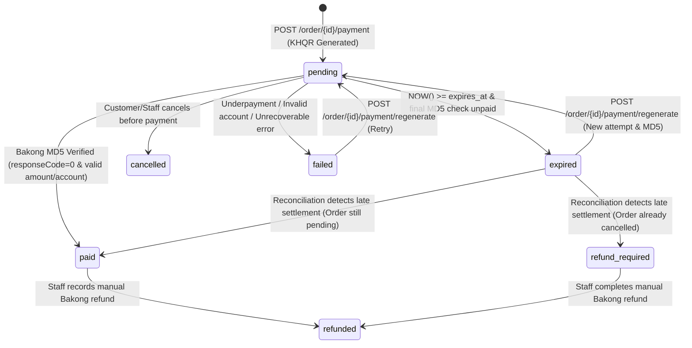

# Step 2: Bakong KHQR Integration Design (`docs/02_BAKONG_DESIGN.md`)

> **Verification Note (Official NBC Bakong Open API & `bakong-khqr` SDK)**:
> Verified against the current National Bank of Cambodia (NBC) Bakong Open API v1 specification (`https://api-bakong.nbc.gov.kh/v1/*` and `https://sit-api-bakong.nbc.gov.kh/v1/*`) and the official PyPI `bakong-khqr` SDK. Any differences between common assumptions and the actual Bakong Open API (such as lack of native webhooks, lack of a refund API, and Cambodia IP restrictions) are explicitly called out below and logged in [`docs/OPEN_QUESTIONS.md`](./OPEN_QUESTIONS.md).

---

## 1. Prerequisites (`[MUST]`)

### 1.1 Bakong Account & Merchant Metadata
To generate EMVCo-compliant KHQR codes via Bakong, you must configure the following parameters (via environment variables / secret manager — **never hardcoded in the repository**):

| Environment Variable | Example Placeholder | EMV Tag | Description |
| :--- | :--- | :--- | :--- |
| `BAKONG_ACCOUNT_ID` | `<merchant_name@bank_code>` | Tag `29` (Individual) / Tag `30` (Merchant) | Registered Bakong account ID (e.g., `coffeeshop@aclb`, `coffeeshop@aba`, `coffeeshop@wing`, `coffeeshop@devb`). |
| `BAKONG_ACCOUNT_TYPE` | `individual` or `merchant` | Tag `29` vs `30` | Individual accounts use Tag `29` (`bakong-khqr` `create_qr`); corporate merchants use Tag `30` (`merchant_id` + `acquiring_bank`). |
| `BAKONG_MERCHANT_ID` | `<merchant-id-if-corporate>` | Tag `30` Sub-tag `01` | Required only when `BAKONG_ACCOUNT_TYPE=merchant`. |
| `BAKONG_ACQUIRING_BANK` | `<Acquiring Bank Name>` | Tag `30` Sub-tag `02` | Acquiring bank name (e.g., `ACLEDA Bank Plc.`, `ABA Bank`). |
| `BAKONG_MERCHANT_NAME` | `Coffee Shop Phnom Penh` | Tag `59` | Merchant display name (max 25 ASCII chars per EMVCo spec). |
| `BAKONG_MERCHANT_CITY` | `Phnom Penh` | Tag `60` | Merchant city (max 15 ASCII chars, default `Phnom Penh`). |
| `BAKONG_MCC` | `5814` | Tag `52` | Merchant Category Code (`5814` = Fast Food / Coffee Shops, or `5812` = Eating Places/Restaurants; default in SDK is `5999`). |
| `BAKONG_STORE_LABEL` | `CoffeeShop-Main` | Tag `62` Sub-tag `03` | Store label embedded in Additional Data Field Template (Tag `62`). |
| `BAKONG_TERMINAL_LABEL` | `WEB-POS-01` | Tag `62` Sub-tag `07` | Terminal identifier embedded in Tag `62`. |
| `BAKONG_PHONE_NUMBER` | `85512345678` | Tag `62` Sub-tag `02` | Merchant contact phone number (digits only, prefix `855`). |

### 1.2 Bakong Open API Access Token Registration, Expiry & Renewal (`[MUST]`)
1. **Registration**:
   - Register a developer/integrator account on the NBC Bakong Open API portal (`https://api-bakong.nbc.gov.kh/register`) using an email address and verify via OTP.
   - Once registered, request or renew a JWT access token using `POST /v1/renew_token` with payload `{"email": "<BAKONG_REGISTERED_EMAIL>"}`.
2. **Token Lifespan & Renewal Process**:
   - Bakong Open API tokens are signed JWTs (`HS256`/`RS256`) containing an `exp` claim (typically valid for **30 to 90 days** depending on NBC issuance tier).
   - **Automated Renewal Strategy**:
     - Store the initial `BAKONG_TOKEN=<set-in-env>` and `BAKONG_REGISTERED_EMAIL=<set-in-env>` in environment secrets.
     - On startup and every 6 hours inside `payment-service`, decode the unverified JWT payload (`jwt.decode(token, options={"verify_signature": False})`) to inspect `exp`.
     - If `exp - now < 7 days` (or if any Bakong API call returns HTTP `401` or `responseCode=1` with `errorCode=6` / token expired), acquire a PostgreSQL advisory lock (`pg_try_advisory_xact_lock(9001)`) and call `POST /v1/renew_token` with `{"email": settings.BAKONG_REGISTERED_EMAIL}` to persist the rotated token in an encrypted `gateway_credentials` PostgreSQL table and emit a warning log / alert if `< 72 hours` remain and auto-renewal fails.

### 1.3 Network & Geo-IP Restrictions (CRITICAL HOSTING IMPACT) (`[MUST]`)
- **Official NBC Perimeter Policy**: Calls to `https://api-bakong.nbc.gov.kh` (`check_transaction_by_md5`, `check_transaction_by_md5_list`, `renew_token`, `generate_deeplink`) are **geo-fenced to Cambodian IP addresses** (or require explicit static egress IP whitelisting with NBC).
- **Hosting Impact & Recommendation**:
  - If your backend (`payment-service`) is hosted on AWS (`ap-southeast-1` Singapore), GCP, Render, Railway, or Fly.io outside Cambodia, direct server-to-server calls to `https://api-bakong.nbc.gov.kh` **will time out or receive HTTP 403/connection resets** unless:
    1. **Option A (Recommended for Production)**: Host `payment-service` (or an egress NAT proxy / WireGuard tunnel) on a Cambodian VPS/cloud provider (e.g., MekongNet, Ezecom, SINET, Sabay Digital, or ByteDC in Phnom Penh) with a static Cambodian public IP, OR submit your cloud NAT Gateway static IP to NBC for whitelisting.
    2. **Option B**: Configure `BAKONG_API_BASE_URL` to route through an authorized Cambodian reverse proxy.

### 1.4 Environments (SIT Sandbox vs Production) (`[MUST]`)
| Environment | Base URL | Notes |
| :--- | :--- | :--- |
| **SIT / Sandbox** | `https://sit-api-bakong.nbc.gov.kh` | Used with NBC Bakong UAT/SIT mobile app (`username@devb` accounts). |
| **Production** | `https://api-bakong.nbc.gov.kh` | Live interbank KHQR clearing across all Bakong member banks (ABA, ACLEDA, Wing, Sathapana, Canadia, etc.). |
| **Local / CI Mock** | Internal `MockBakongClient` (`BAKONG_MOCK_MODE=true`) | Deterministic local simulation without network calls; required for CI and unattended testing. |

---

## 2. Microservice Architecture & Service Boundaries (`[MUST]`)

### 2.1 Service Boundaries
To preserve the existing microservice architecture (`user_service` on `:8001`, `operation_service` on `:8002`, `report_service` on `:8003`) while establishing clean domain isolation:

1. **`payment_service` (`:8004`, DB: `payment_service_db`)** (`[MUST]`):
   - Owns the payment lifecycle, EMVCo KHQR generation, MD5 computation, Bakong Open API client, PostgreSQL `SKIP LOCKED` verification worker, reconciliation scheduler, idempotency store, and immutable payment audit trail (`payment_events`).
   - Exposes REST endpoints under `/payment/*` for the frontend and internal microservices.
   - Notifies `operation_service` via signed internal service-JWT REST webhook (`POST /order/{order_id}/payment-webhook` or `PATCH /order/{order_id}/status`) when a payment transitions to `paid` or `expired`.
2. **`operation_service` (`:8002`, DB: `operation_service_db`)** (`[MUST]`):
   - Owns catalog, stock, and order state (`pending -> paid -> completed | cancelled`).
   - Maintains backward-compatible `POST /order/{order_id}/payment` and `GET /order/{order_id}/payment` endpoints that either delegate to `payment_service` or use the shared `BakongKHQRGateway` implementation so existing clients and integration tests continue working seamlessly.
3. **`user_service` (`:8001`, DB: `user_service_db`)**:
   - Issues customer/staff/admin JWTs verified statelessly by `payment_service` using `JWT_SECRET_KEY`.
4. **Notification Boundary (Internal Module / Future `notification_service`)** (`[SHOULD]`):
   - Triggered on payment state transitions (`paid`, `expired`, `refunded`) via PostgreSQL `NOTIFY payment_events_channel, '<json>'` so SSE/WebSocket listeners or email/Telegram workers can push real-time updates without Redis.

### 2.2 Sequence Diagrams (Mermaid)

#### A. Create Payment, KHQR Generation, Customer Scans & Pays, Verification & Success
```mermaid
sequenceDiagram
    autonumber
    actor Customer as Customer (Browser / Mobile)
    participant FE as Next.js Frontend
    participant OS as operation_service (:8002)
    participant PS as payment_service (:8004)
    participant DB as PostgreSQL (payment_service_db)
    participant Worker as PG Verification Worker (SKIP LOCKED)
    participant Bakong as NBC Bakong Open API

    Customer->>FE: Click "Checkout & Pay with Bakong KHQR"
    FE->>OS: POST /order (items, customizations)
    OS->>OS: Lock products (FOR UPDATE), decrement stock, create Order(status='pending')
    OS-->>FE: 200 OK { order_id: 42, total_amount: "4.50", status: "pending" }

    FE->>PS: POST /payment/khqr (Idempotency-Key: <uuid>, order_id: 42, currency: "USD")
    PS->>DB: Check idempotency_keys & lock active payment for order_id=42
    PS->>OS: GET /order/42 (verify owner, status=='pending', authoritative total_amount=4.50)
    PS->>PS: Generate Dynamic EMVCo KHQR (Tag 29/30, Tag 54=4.50, Tag 99=expires_at_ms, Tag 63=CRC16)
    PS->>PS: Compute qr_md5 = MD5(qr_string)
    PS->>DB: INSERT payments(status='pending'), payment_attempts, verification_jobs(next_run_at=now+3s), payment_events
    PS-->>FE: 200 OK { payment_id, qr_string, qr_md5, amount: "4.50", currency: "USD", expires_at, deeplink }

    FE->>Customer: Render KHQR + Countdown Timer (180s) + "Open in Bank App" button
    Customer->>Bakong: Scans KHQR in Bakong / ABA / ACLEDA App & confirms transfer

    loop Every 3s..10s (Backoff) until Paid or Expired
        Worker->>DB: SELECT ... FROM verification_jobs WHERE status='queued' AND next_run_at <= now() FOR UPDATE SKIP LOCKED
        Worker->>Bakong: POST /v1/check_transaction_by_md5 { "md5": qr_md5 }
        alt Transaction Found (responseCode == 0)
            Bakong-->>Worker: 200 OK { responseCode: 0, data: { hash, fromAccountId, toAccountId, amount: 4.50, currency: "USD" } }
            Worker->>Worker: Validate toAccountId == BAKONG_ACCOUNT_ID, currency == "USD", amount >= 4.50
            Worker->>DB: SELECT ... FROM payments WHERE id = payment_id FOR UPDATE
            Worker->>DB: UPDATE payments SET status='paid', paid_at=now(), bakong_tx_hash=hash, payer_account=mask(fromAccountId)
            Worker->>DB: UPDATE verification_jobs SET status='completed'; INSERT payment_events('payment.paid'); NOTIFY payment_status
            Worker->>OS: PATCH /order/42/status { "status": "paid" } (Service JWT)
            OS-->>Worker: 200 OK (Order #42 -> 'paid')
        else Not Paid Yet (responseCode == 1, errorCode == 1)
            Bakong-->>Worker: 200 OK { responseCode: 1, errorCode: 1, responseMessage: "Transaction could not be found" }
            Worker->>DB: UPDATE verification_jobs SET attempt_count += 1, next_run_at = now() + backoff
        end
    end

    FE->>PS: GET /payment/42/status (Polling every 3s or SSE)
    PS-->>FE: 200 OK { status: "paid", paid_at, transaction_ref }
    FE->>Customer: Redirect to Success Screen / Order #42 Paid!
```

#### B. Payment Expiry, Late Payment Reconciliation & Manual Refund Flow
```mermaid
sequenceDiagram
    autonumber
    actor Customer
    participant FE as Next.js Frontend
    participant PS as payment_service
    participant Worker as PG Verification Worker / Reconciler
    participant DB as PostgreSQL
    participant OS as operation_service
    participant Bakong as NBC Bakong Open API
    actor Staff as Store Staff / Admin

    Note over Customer,Bakong: Case 1: QR Expires Before Payment
    Worker->>DB: Poll job where now() >= payment.expires_at
    Worker->>Bakong: Final check: POST /v1/check_transaction_by_md5 { "md5": qr_md5 }
    Bakong-->>Worker: { responseCode: 1, errorCode: 1 } (Not found)
    Worker->>DB: UPDATE payments SET status='expired' WHERE status='pending'
    Worker->>DB: INSERT payment_events('payment.expired')
    FE->>PS: GET /payment/42/status
    PS-->>FE: { status: "expired" }
    FE->>Customer: Show "QR Expired" + "Regenerate KHQR" button

    Note over Customer,Bakong: Case 2: Late Payment (Customer scanned before expiry, confirmed in bank app 10s after expiry)
    Worker->>DB: Reconciliation Job scans 'expired' payments from last 30 mins
    Worker->>Bakong: POST /v1/check_transaction_by_md5_list { "md5List": [...] }
    Bakong-->>Worker: Match found for qr_md5! (responseCode == 0)
    alt Order #42 is still 'pending'
        Worker->>DB: UPDATE payments SET status='paid', paid_at=now(); INSERT payment_events('payment.late_recovered')
        Worker->>OS: PATCH /order/42/status { "status": "paid" }
    else Order #42 was already 'cancelled' (stock restored)
        Worker->>DB: UPDATE payments SET status='refund_required'; INSERT refunds(status='pending_manual', reason='late_payment_on_cancelled_order')
        Worker->>DB: INSERT payment_events('payment.conflict_refund_required')
    end

    Note over Staff,DB: Case 3: Manual / Off-Gateway Refund (Bakong Open API has NO programmatic refund endpoint)
    Staff->>FE: Open Order #42 -> Click "Record Refund"
    Staff->>Customer: Transfers refund via Bakong Merchant App / Bank Portal & copies Bakong Tx Ref
    FE->>PS: POST /payment/42/refund { amount, reason, external_refund_ref }
    PS->>DB: UPDATE payments SET status='refunded'; UPDATE refunds SET status='completed', refunded_at=now()
    PS->>OS: PATCH /order/42/status { "status": "cancelled" } (restocks items if needed)
```

---

## 3. KHQR Generation Specification (`[MUST]`)

### 3.1 Dynamic KHQR vs Static KHQR
- **Static KHQR** (`Point of Initiation Method` Tag `01` = `11`): Has no embedded amount (`Tag 54`) and no expiration timestamp (`Tag 99`). The customer must type the amount manually in their banking app, which is prone to human error (underpayment/wrong currency) and cannot be uniquely matched per order via `qr_md5`.
- **Dynamic KHQR** (`Point of Initiation Method` Tag `01` = `12`) (`[MUST]`):
  - Embeds the exact order amount (`Tag 54`), currency (`Tag 53`: `840` for USD, `116` for KHR), unique bill reference (`Tag 62` sub-tag `01` = `ORD-{order_id}-{attempt_no}`), and millisecond expiration timestamp (`Tag 99` sub-tag `01`).
  - Produces a unique QR payload string per payment attempt whose 32-char lowercase hex MD5 (`qr_md5`) uniquely identifies the transaction on the Bakong network.

### 3.2 SDK vs Custom EMVCo + CRC16-CCITT Implementation Comparison
| Criteria | Official `bakong-khqr` PyPI SDK (`v0.4+`) | Custom EMVCo TLV + CRC16-CCITT Builder |
| :--- | :--- | :--- |
| **NBC Specification Compliance** | Maintained to match NBC KHQR Tag `29`/`30`/`62`/`99` rules | Must manually maintain Tag lengths & sub-tags |
| **External Runtime Dependency** | Lightweight pure-Python (`requests`/`urllib`) | Zero external dependencies |
| **Offline Unit Testability** | `create_qr()` & `generate_md5()` run 100% offline; `check_payment()` calls HTTP | 100% offline |
| **Recommendation** | **Use `bakong-khqr` for QR & MD5 generation (or wrap it with our deterministic EMVCo builder fallback) + use `httpx.AsyncClient`/`httpx.Client` for Bakong Open API HTTP calls** so timeouts, retries, bulk MD5 checks (`check_transaction_by_md5_list`), and `respx` mocking in pytest work natively with FastAPI. |

### 3.3 Currency, Precision, Reference & Expiration Rules (`[MUST]`)
1. **Currency (`Tag 53`) & Precision (`Tag 54`)**:
   - **USD (`ISO 4217 = 840`)**: `Numeric(12, 2)`. Minimum amount `0.01`. Formatted with 2 decimal places (e.g., `4.50`).
   - **KHR (`ISO 4217 = 116`)**: Integer only (`Numeric(12, 0)` — no decimals/sen allowed in KHQR; e.g., `18000`). If the store prices products in USD and the customer chooses KHR at checkout, convert using the configured store exchange rate (e.g., `BAKONG_USD_TO_KHR_RATE=4100`, rounded to the nearest `100 KHR`), and store both `order_amount_usd` and `amount` + `currency='KHR'` on the payment attempt.
2. **Bill Number / Reference (`Tag 62` Sub-tag `01`)**:
   - Format: `ORD-{order_id}-A{attempt_number}` (max 25 chars, e.g., `ORD-42-A1`).
   - Ensures that regenerating an expired QR for the same order produces a brand-new `qr_string` and a distinct `qr_md5`.
3. **Expiration Handling (`Tag 99`)**:
   - Default TTL: **180 seconds (3 minutes)** (`BAKONG_QR_EXPIRY_SECONDS=180`).
   - Embedded in Tag `99` (`00` = creation epoch ms, `01` = expiration epoch ms, 13-digit milliseconds).
4. **MD5 Hash (`qr_md5`)**:
   - Computed as `hashlib.md5(qr_string.encode("utf-8")).hexdigest().lower()`.
   - Stored with a `UNIQUE` index in `payment_attempts.qr_md5` and `payments.qr_md5`.
5. **Mobile Deeplink Generation**:
   - Calls `POST /v1/generate_deeplink_by_qr` (or `khqr.generate_deeplink(...)`) with `{ "qr": qr_string, "sourceInfo": { "appIconUrl": ..., "appName": "Coffee Shop", "appDeepLinkCallback": "https://.../orders/42" } }`.
   - **Resilience Fallback**: If the Bakong deeplink API is unreachable, KHQR generation still succeeds (`deeplink_url = null`), and the customer can still scan the QR code or save the QR image to scan from gallery in ABA/Bakong/ACLEDA.

---

## 4. Payment Verification & PostgreSQL Worker Design (`[MUST]`)

### 4.1 Webhook Reality Check
- **Does NBC Bakong Open API provide webhooks?**
  - **No.** The standard NBC Bakong Open API (`api-bakong.nbc.gov.kh`) does **not** push webhook callbacks to merchant servers when a KHQR is paid.
  - Therefore, **server-side polling via `POST /v1/check_transaction_by_md5` and `POST /v1/check_transaction_by_md5_list` is mandatory**, supplemented by an instant "I have paid — check now" endpoint (`POST /payment/{order_id}/verify-now`, rate-limited) and a background PostgreSQL worker.

### 4.2 PostgreSQL `FOR UPDATE SKIP LOCKED` Verification Worker
Because Redis, RabbitMQ, and Celery are prohibited by our tech stack constraints, we use a PostgreSQL-backed job queue (`verification_jobs` table):

```sql
-- Claim up to 25 due verification jobs across concurrent worker processes without lock contention
WITH due_jobs AS (
    SELECT id
    FROM verification_jobs
    WHERE status = 'queued'
      AND next_run_at <= NOW()
    ORDER BY next_run_at ASC
    LIMIT 25
    FOR UPDATE SKIP LOCKED
)
UPDATE verification_jobs vj
SET status = 'processing',
    locked_at = NOW(),
    locked_by = :worker_id,
    updated_at = NOW()
FROM due_jobs
WHERE vj.id = due_jobs.id
RETURNING vj.*;
```

- **Polling Backoff Schedule**:
  - Attempts 1–10 (first 30s): every **3 seconds** (fast feedback while customer has bank app open).
  - Attempts 11–22 (30s–90s): every **5 seconds**.
  - Attempts 23–31 (90s–180s): every **10 seconds**.
  - When `NOW() >= expires_at`: perform 1 final check; if still unpaid, transition payment to `expired` and mark job `completed`.
- **Batch Optimization (`check_transaction_by_md5_list`)**:
  - When multiple `verification_jobs` are claimed in one tick (e.g., 2–25 jobs), the worker sends a single batch request to `POST /v1/check_transaction_by_md5_list` with `{"md5List": [...]}` instead of N separate HTTP calls!

### 4.3 Strict Server-Side Validation (`[MUST]`)
When Bakong returns `responseCode == 0` with `data`:
1. **Receiver Account Match**: `data["toAccountId"].lower() == settings.BAKONG_ACCOUNT_ID.lower()` (prevents spoofing a valid MD5 from a different merchant's QR).
2. **Currency Match**: `data["currency"].upper() == payment.currency.upper()`.
3. **Amount Validation**: `Decimal(str(data["amount"])) == payment.amount` (exact match for dynamic QR; see edge cases below for underpay/overpay).
4. **Unique Bakong Transaction Hash**: `data["hash"]` must not already be linked to another `paid` order (`UNIQUE` index on `bakong_transaction_hash`).

### 4.4 Edge Cases Matrix (`[MUST]`)
| Edge Case | Detection Mechanism | System Behavior |
| :--- | :--- | :--- |
| **1. Customer pays after QR expiry** | Reconciliation job runs every 60s checking `expired` payments from the last 30 minutes via `check_transaction_by_md5_list`. | If `order.status == 'pending'`, promote payment to `paid`, log `payment.late_recovered`, and advance order to `paid`. If `order.status == 'cancelled'`, mark payment `refund_required`, create a `refunds` row (`pending_manual`), and alert staff. |
| **2. Underpayment** (`paid_amount < expected_amount`) | `Decimal(str(data["amount"])) < payment.amount` | Reject order progression; set `payment.status = 'failed'`, `failure_reason = 'underpaid'`, create `refunds` record (`pending_manual`) for the partial amount, and log critical `payment.amount_mismatch` event. |
| **3. Overpayment** (`paid_amount > expected_amount`) | `Decimal(str(data["amount"])) > payment.amount` | Mark payment `paid` (so customer gets their coffee!), record `paid_amount`, and create a `refunds` record for `paid_amount - expected_amount` (`reason='overpayment_excess'`). |
| **4. Duplicate payment for same order** | Customer regenerated QR (`Attempt #2`) and accidentally paid both `Attempt #1` and `Attempt #2`. | First verified attempt moves `Order` to `paid`. Second verified attempt detects `order.status == 'paid'` (under `SELECT ... FOR UPDATE` on `payments`), records the second `payment_attempt` as `duplicate_paid`, and automatically inserts a `refunds` record (`reason='duplicate_payment'`). |
| **5. Bakong API timeout / 5xx downtime** | `httpx.TimeoutException` or HTTP `500/502/503/504` | Worker increments `attempt_count`, records `last_error`, and reschedules `next_run_at = NOW() + exponential_backoff_with_jitter`. Does **not** mark payment `failed` while within expiration + grace window. |
| **6. Bakong API token expired (`401` / `errorCode=6`)** | HTTP `401` or `errorCode == 6` | Worker acquires advisory lock `9001`, calls `POST /v1/renew_token`, updates the cached token, and immediately retries the MD5 check without losing the job. |
| **7. Concurrent worker + manual `verify-now` race** | Both worker and customer click "Check Payment" at the exact same millisecond. | Both paths execute `SELECT * FROM payments WHERE id = :id FOR UPDATE`. The first transaction updates `status = 'paid'`; the second sees `status == 'paid'` and returns idempotently without double-updating `operation_service`. |

---

## 5. API Contract (OpenAPI / Pydantic Schemas) (`[MUST]`)

To maintain 100% compatibility with the existing coffee shop platform while adding full Bakong KHQR capabilities, all endpoints return the standard `ApiResponse[T]` envelope:

### 5.1 Endpoints Summary
| Method | Path | Auth | Idempotency | Description |
| :--- | :--- | :--- | :--- | :--- |
| `POST` | `/order/{order_id}/payment` | Owner, Staff, Admin | `Idempotency-Key` header (optional, defaults to active pending attempt) | Creates or returns an active dynamic Bakong KHQR payment for `order_id` (`method="khqr"` or `"cash"` for staff POS). |
| `GET` | `/order/{order_id}/payment` | Owner, Staff, Admin | Safe GET | Gets current payment status, QR payload, countdown `expires_at`, and deeplink for `order_id`. |
| `POST` | `/order/{order_id}/payment/verify` | Owner, Staff, Admin | Lock-safe | Immediately triggers a live Bakong MD5 check for `order_id` (rate-limited to 1 req / 2s per order) and returns updated `PaymentResponse`. |
| `POST` | `/order/{order_id}/payment/regenerate` | Owner, Staff, Admin | `Idempotency-Key` | Expires any previous pending QR attempt and generates a fresh dynamic KHQR with a new `qr_md5` and 180s timer. |
| `POST` | `/order/{order_id}/payment/cancel` | Owner, Staff, Admin | Lock-safe | Cancels a `pending` payment attempt (if not yet paid on Bakong). |
| `POST` | `/order/{order_id}/payment/refund` | Staff, Admin | `Idempotency-Key` | Records a manual/off-gateway Bakong refund reference and transitions payment to `refunded`. |

### 5.2 Pydantic Models (`payment_schema.py`)

```python
from datetime import datetime
from decimal import Decimal
from typing import Literal
from pydantic import BaseModel, ConfigDict, Field

PaymentMethodType = Literal["khqr", "cash"]
PaymentCurrencyType = Literal["USD", "KHR"]
PaymentStatusType = Literal[
    "pending",
    "paid",
    "success",  # alias kept for backward compatibility with existing frontend badge/checks
    "failed",
    "expired",
    "cancelled",
    "refund_required",
    "refunded",
]


class CreatePaymentRequest(BaseModel):
    method: PaymentMethodType = Field(default="khqr", description="Payment method: 'khqr' (Bakong KHQR) or 'cash' (staff only)")
    currency: PaymentCurrencyType = Field(default="USD", description="KHQR settlement currency: USD or KHR")
    idempotency_key: str | None = Field(default=None, max_length=64, description="Client idempotency UUID")


class RefundPaymentRequest(BaseModel):
    amount: Decimal = Field(gt=0, description="Refunded amount")
    reason: str = Field(min_length=3, max_length=255)
    external_refund_ref: str = Field(min_length=3, max_length=128, description="Bakong app transfer reference / hash")


class PaymentResponse(BaseModel):
    model_config = ConfigDict(from_attributes=True)

    id: int
    order_id: int
    amount: Decimal
    currency: str = "USD"
    method: str
    status: str
    transaction_ref: str
    qr_string: str | None = None
    qr_md5: str | None = None
    deeplink_url: str | None = None
    merchant_name: str | None = None
    expires_at: datetime | None = None
    paid_at: datetime | None = None
    bakong_transaction_hash: str | None = None
    payer_account_masked: str | None = None
    failure_reason: str | None = None
    created_at: datetime | None = None
    updated_at: datetime | None = None
```

---

## 6. PostgreSQL Schema (DDL) & State Machine (`[MUST]`)

### 6.1 Payment State Machine



### 6.2 Complete PostgreSQL DDL (`migrations/versions/0001_bakong_khqr_schema.sql`)

```sql
-- 1. Payment Status & Currency Constraints (using CHECK constraints for zero-downtime migrations)
ALTER TABLE payments
    ADD COLUMN IF NOT EXISTS currency VARCHAR(3) NOT NULL DEFAULT 'USD',
    ADD COLUMN IF NOT EXISTS qr_string TEXT NULL,
    ADD COLUMN IF NOT EXISTS qr_md5 VARCHAR(32) NULL,
    ADD COLUMN IF NOT EXISTS deeplink_url TEXT NULL,
    ADD COLUMN IF NOT EXISTS expires_at TIMESTAMPTZ NULL,
    ADD COLUMN IF NOT EXISTS paid_at TIMESTAMPTZ NULL,
    ADD COLUMN IF NOT EXISTS bakong_transaction_hash VARCHAR(128) NULL,
    ADD COLUMN IF NOT EXISTS payer_account_masked VARCHAR(64) NULL,
    ADD COLUMN IF NOT EXISTS receiver_account VARCHAR(64) NULL,
    ADD COLUMN IF NOT EXISTS attempt_count INTEGER NOT NULL DEFAULT 1;

CREATE UNIQUE INDEX IF NOT EXISTS ix_payments_qr_md5
    ON payments (qr_md5) WHERE qr_md5 IS NOT NULL;

CREATE UNIQUE INDEX IF NOT EXISTS ix_payments_bakong_tx_hash
    ON payments (bakong_transaction_hash) WHERE bakong_transaction_hash IS NOT NULL;

CREATE INDEX IF NOT EXISTS ix_payments_status_expires_at
    ON payments (status, expires_at);

-- 2. payment_attempts (supports regenerating expired QR codes while preserving history of every QR MD5)
CREATE TABLE IF NOT EXISTS payment_attempts (
    id SERIAL PRIMARY KEY,
    payment_id INTEGER NOT NULL REFERENCES payments(id) ON DELETE CASCADE,
    order_id INTEGER NOT NULL REFERENCES orders(id) ON DELETE CASCADE,
    attempt_number INTEGER NOT NULL,
    amount NUMERIC(12, 2) NOT NULL,
    currency VARCHAR(3) NOT NULL DEFAULT 'USD',
    qr_string TEXT NOT NULL,
    qr_md5 VARCHAR(32) NOT NULL UNIQUE,
    deeplink_url TEXT NULL,
    bill_number VARCHAR(64) NOT NULL,
    status VARCHAR(24) NOT NULL DEFAULT 'pending',
    expires_at TIMESTAMPTZ NOT NULL,
    paid_at TIMESTAMPTZ NULL,
    bakong_transaction_hash VARCHAR(128) NULL UNIQUE,
    payer_account_masked VARCHAR(64) NULL,
    raw_bakong_response JSONB NULL,
    failure_reason VARCHAR(255) NULL,
    created_at TIMESTAMPTZ NOT NULL DEFAULT NOW(),
    updated_at TIMESTAMPTZ NOT NULL DEFAULT NOW(),
    CONSTRAINT uq_payment_attempt_number UNIQUE (payment_id, attempt_number),
    CONSTRAINT chk_attempt_currency CHECK (currency IN ('USD', 'KHR')),
    CONSTRAINT chk_attempt_amount_positive CHECK (amount > 0)
);

CREATE INDEX IF NOT EXISTS ix_payment_attempts_order_id ON payment_attempts (order_id);
CREATE INDEX IF NOT EXISTS ix_payment_attempts_status_expires ON payment_attempts (status, expires_at);

-- 3. payment_events (Immutable append-only audit log)
CREATE TABLE IF NOT EXISTS payment_events (
    id BIGSERIAL PRIMARY KEY,
    payment_id INTEGER NOT NULL REFERENCES payments(id) ON DELETE CASCADE,
    order_id INTEGER NOT NULL,
    event_type VARCHAR(64) NOT NULL, -- e.g. 'khqr.generated', 'verification.polled', 'payment.paid', 'payment.expired', 'payment.refunded'
    previous_status VARCHAR(24) NULL,
    new_status VARCHAR(24) NULL,
    qr_md5 VARCHAR(32) NULL,
    actor VARCHAR(64) NOT NULL DEFAULT 'system', -- 'customer:<id>', 'staff:<id>', 'worker', 'reconciler'
    metadata_json TEXT NULL,
    created_at TIMESTAMPTZ NOT NULL DEFAULT NOW()
);

CREATE INDEX IF NOT EXISTS ix_payment_events_payment_id ON payment_events (payment_id, created_at DESC);
CREATE INDEX IF NOT EXISTS ix_payment_events_order_id ON payment_events (order_id);

-- 4. refunds (Manual / off-gateway Bakong refund tracking)
CREATE TABLE IF NOT EXISTS refunds (
    id SERIAL PRIMARY KEY,
    payment_id INTEGER NOT NULL REFERENCES payments(id) ON DELETE RESTRICT,
    order_id INTEGER NOT NULL REFERENCES orders(id) ON DELETE RESTRICT,
    amount NUMERIC(12, 2) NOT NULL CHECK (amount > 0),
    currency VARCHAR(3) NOT NULL DEFAULT 'USD',
    reason VARCHAR(255) NOT NULL,
    status VARCHAR(24) NOT NULL DEFAULT 'pending_manual', -- 'pending_manual', 'completed', 'cancelled'
    external_refund_ref VARCHAR(128) NULL,
    processed_by_user_id INTEGER NULL,
    refunded_at TIMESTAMPTZ NULL,
    created_at TIMESTAMPTZ NOT NULL DEFAULT NOW(),
    updated_at TIMESTAMPTZ NOT NULL DEFAULT NOW()
);

CREATE INDEX IF NOT EXISTS ix_refunds_order_id ON refunds (order_id);

-- 5. idempotency_keys (PostgreSQL native idempotency store)
CREATE TABLE IF NOT EXISTS idempotency_keys (
    id SERIAL PRIMARY KEY,
    idempotency_key VARCHAR(64) NOT NULL,
    user_id INTEGER NOT NULL,
    endpoint VARCHAR(128) NOT NULL,
    request_hash VARCHAR(64) NOT NULL,
    response_status INTEGER NOT NULL,
    response_body TEXT NOT NULL,
    created_at TIMESTAMPTZ NOT NULL DEFAULT NOW(),
    expires_at TIMESTAMPTZ NOT NULL,
    CONSTRAINT uq_idempotency_key_user_endpoint UNIQUE (idempotency_key, user_id, endpoint)
);

CREATE INDEX IF NOT EXISTS ix_idempotency_keys_expires_at ON idempotency_keys (expires_at);

-- 6. verification_jobs (PostgreSQL FOR UPDATE SKIP LOCKED background worker queue)
CREATE TABLE IF NOT EXISTS verification_jobs (
    id BIGSERIAL PRIMARY KEY,
    payment_id INTEGER NOT NULL REFERENCES payments(id) ON DELETE CASCADE,
    attempt_id INTEGER NULL REFERENCES payment_attempts(id) ON DELETE CASCADE,
    order_id INTEGER NOT NULL,
    qr_md5 VARCHAR(32) NOT NULL UNIQUE,
    status VARCHAR(20) NOT NULL DEFAULT 'queued', -- 'queued', 'processing', 'completed', 'dead_letter'
    attempt_count INTEGER NOT NULL DEFAULT 0,
    max_attempts INTEGER NOT NULL DEFAULT 40,
    next_run_at TIMESTAMPTZ NOT NULL DEFAULT NOW(),
    locked_at TIMESTAMPTZ NULL,
    locked_by VARCHAR(64) NULL,
    last_error VARCHAR(255) NULL,
    created_at TIMESTAMPTZ NOT NULL DEFAULT NOW(),
    updated_at TIMESTAMPTZ NOT NULL DEFAULT NOW()
);

CREATE INDEX IF NOT EXISTS ix_verification_jobs_poll
    ON verification_jobs (status, next_run_at)
    WHERE status = 'queued';
```

---

## 7. Reliability & Security Controls (`[MUST]`)

1. **Idempotency on Create/Regenerate Payment**:
   - Clients pass `Idempotency-Key` header or `idempotency_key` in the body.
   - Even without an explicit key, if a `pending` payment attempt for `order_id` exists and `expires_at > NOW() + 15s` with the same currency and amount, `POST /order/{order_id}/payment` returns the **existing active KHQR** rather than creating duplicate attempts.
2. **Row-Level Locking (`SELECT ... FOR UPDATE`)**:
   - All payment state transitions acquire a row lock on `Payment` (`db.query(Payment).filter(Payment.id == payment_id).with_for_update().first()`) before checking current status and updating `Order`.
3. **PII Masking (`payer_account_masked`)**:
   - Payer Bakong IDs returned in `fromAccountId` (e.g., `sokha_chan@aba` or `85512345678@wing`) are masked before storage and API exposure: `so***an@aba` (`mask_bakong_account()`).
   - Never log `BAKONG_TOKEN`, `JWT_SECRET_KEY`, or unmasked customer phone numbers/account IDs.
4. **Rate Limiting (PostgreSQL-backed / In-Memory Token Bucket)**:
   - `POST /order/{order_id}/payment/verify` is rate-limited to **1 request per 2 seconds per `order_id`** (and reuses the latest state if polled faster) to protect the Bakong Open API from client spam.

---

## 8. Frontend Checkout & KHQR Flow (Next.js 15 App Router) (`[MUST]`)

1. **Cart & Order Checkout**:
   - In [`CartDialog`](file:///D:/Study/Year-4/Python/coffee_shop_frontend/src/features/cart/components/cart-dialog.tsx) and [`PayDialog`](file:///D:/Study/Year-4/Python/coffee_shop_frontend/src/features/payment/components/pay-dialog.tsx), replace fake `card` / `e_wallet` options with **Bakong KHQR (USD / KHR)** (plus **Cash at Counter** for `staff`/`admin` roles).
2. **KHQR Payment Modal / View (`PayDialog` & `/orders/[id]`)**:
   - Displays the official KHQR header badge (Red `#E1232E` banner with merchant name & total amount formatted in USD or KHR).
   - Renders the scannable QR code SVG directly from `payment.qr_string` (client-side SVG matrix renderer or lightweight QR component — zero external image leakage of QR payloads to third-party QR APIs!).
   - Live countdown timer (`MM:SS` remaining until `payment.expires_at`).
   - **Auto-Polling with Cleanup**:
     - `usePaymentStatusPoll(orderId, enabled)` uses TanStack Query `refetchInterval: 3000` ONLY while `payment.status === 'pending'` and `expires_at > now`, automatically stopping when `paid`, `expired`, `failed`, or when the dialog/page unmounts (preventing memory leaks).
   - **Mobile "Open in Bank App" Button**:
     - Shown on mobile viewports when `payment.deeplink_url` is available, plus a **"Check Payment Status Now"** button (`POST /order/{id}/payment/verify`).
   - **Expired / Failed Recovery**:
     - When the countdown reaches `00:00` or `payment.status === 'expired'`, overlays an "Expired" state on the QR with a one-click **"Regenerate KHQR"** button (`POST /order/{id}/payment/regenerate`).
