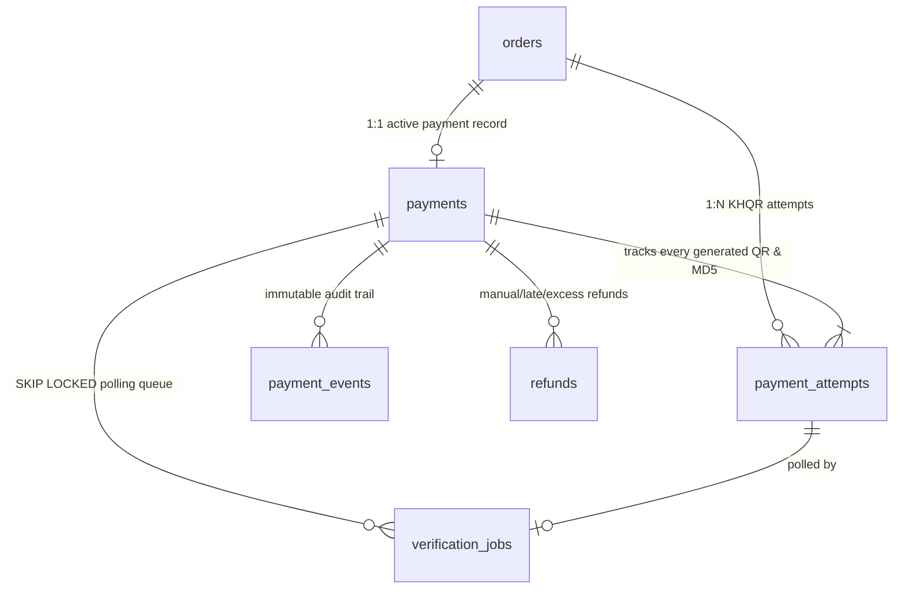

# Deliverable 2: Database Schema & Alembic Migration Scripts (`docs/05_DB_SCHEMA_AND_MIGRATIONS.md`)

> **Constraint Compliance**: PostgreSQL ONLY (`FOR UPDATE SKIP LOCKED`, `pg_try_advisory_xact_lock`, unique constraints, `LISTEN/NOTIFY`). No Redis, RabbitMQ, or MongoDB.
> **Executable Alembic Scripts Created in Repo**:
> - [`coffee_shop/operation_service/alembic.ini`](file:///D:/Study/Year-4/Python/coffee_shop/operation_service/alembic.ini)
> - [`coffee_shop/operation_service/migrations/env.py`](file:///D:/Study/Year-4/Python/coffee_shop/operation_service/migrations/env.py)
> - [`coffee_shop/operation_service/migrations/versions/0001_bakong_khqr_schema.py`](file:///D:/Study/Year-4/Python/coffee_shop/operation_service/migrations/versions/0001_bakong_khqr_schema.py)

---

## 1. Entity-Relationship Diagram (Bakong KHQR Schema)



---

## 2. Production PostgreSQL DDL

```sql
-- ============================================================================
-- Bakong KHQR Payment Gateway Schema (PostgreSQL 15+)
-- ============================================================================

-- 1. Extend `payments` table
ALTER TABLE payments
    ADD COLUMN IF NOT EXISTS currency VARCHAR(3) NOT NULL DEFAULT 'USD',
    ADD COLUMN IF NOT EXISTS qr_string TEXT NULL,
    ADD COLUMN IF NOT EXISTS qr_md5 VARCHAR(32) NULL,
    ADD COLUMN IF NOT EXISTS deeplink_url VARCHAR(512) NULL,
    ADD COLUMN IF NOT EXISTS expires_at TIMESTAMPTZ NULL,
    ADD COLUMN IF NOT EXISTS paid_at TIMESTAMPTZ NULL,
    ADD COLUMN IF NOT EXISTS bakong_transaction_hash VARCHAR(128) NULL,
    ADD COLUMN IF NOT EXISTS payer_account_masked VARCHAR(64) NULL,
    ADD COLUMN IF NOT EXISTS receiver_account VARCHAR(64) NULL,
    ADD COLUMN IF NOT EXISTS attempt_count INTEGER NOT NULL DEFAULT 1;

CREATE UNIQUE INDEX IF NOT EXISTS ix_payments_qr_md5
    ON payments (qr_md5) WHERE qr_md5 IS NOT NULL;

CREATE UNIQUE INDEX IF NOT EXISTS ix_payments_bakong_tx_hash
    ON payments (bakong_transaction_hash) WHERE bakong_transaction_hash IS NOT NULL;

CREATE INDEX IF NOT EXISTS ix_payments_status_expires_at
    ON payments (status, expires_at);

-- 2. `payment_attempts` table (each QR generation / regeneration creates an immutable attempt)
CREATE TABLE IF NOT EXISTS payment_attempts (
    id SERIAL PRIMARY KEY,
    payment_id INTEGER NOT NULL REFERENCES payments(id) ON DELETE CASCADE,
    order_id INTEGER NOT NULL REFERENCES orders(id) ON DELETE CASCADE,
    attempt_number INTEGER NOT NULL DEFAULT 1,
    amount NUMERIC(12, 2) NOT NULL CHECK (amount > 0),
    currency VARCHAR(3) NOT NULL DEFAULT 'USD' CHECK (currency IN ('USD', 'KHR')),
    qr_string TEXT NOT NULL,
    qr_md5 VARCHAR(32) NOT NULL UNIQUE,
    deeplink_url VARCHAR(512) NULL,
    bill_number VARCHAR(64) NOT NULL,
    status VARCHAR(24) NOT NULL DEFAULT 'pending',
    expires_at TIMESTAMPTZ NOT NULL,
    paid_at TIMESTAMPTZ NULL,
    bakong_transaction_hash VARCHAR(128) NULL UNIQUE,
    payer_account_masked VARCHAR(64) NULL,
    raw_bakong_response TEXT NULL,
    failure_reason VARCHAR(255) NULL,
    created_at TIMESTAMPTZ NOT NULL DEFAULT NOW(),
    updated_at TIMESTAMPTZ NOT NULL DEFAULT NOW(),
    CONSTRAINT uq_payment_attempt_number UNIQUE (payment_id, attempt_number)
);

CREATE INDEX IF NOT EXISTS ix_payment_attempts_order_id ON payment_attempts (order_id);

-- 3. `payment_events` (Append-only audit trail)
CREATE TABLE IF NOT EXISTS payment_events (
    id BIGSERIAL PRIMARY KEY,
    payment_id INTEGER NOT NULL REFERENCES payments(id) ON DELETE CASCADE,
    order_id INTEGER NOT NULL,
    event_type VARCHAR(64) NOT NULL,
    previous_status VARCHAR(24) NULL,
    new_status VARCHAR(24) NULL,
    qr_md5 VARCHAR(32) NULL,
    actor VARCHAR(64) NOT NULL DEFAULT 'system',
    metadata_json TEXT NULL,
    created_at TIMESTAMPTZ NOT NULL DEFAULT NOW()
);

CREATE INDEX IF NOT EXISTS ix_payment_events_payment_id ON payment_events (payment_id, created_at DESC);
CREATE INDEX IF NOT EXISTS ix_payment_events_order_id ON payment_events (order_id);

-- 4. `refunds` (Off-gateway / manual Bakong refund ledger)
CREATE TABLE IF NOT EXISTS refunds (
    id SERIAL PRIMARY KEY,
    payment_id INTEGER NOT NULL REFERENCES payments(id) ON DELETE CASCADE,
    order_id INTEGER NOT NULL REFERENCES orders(id) ON DELETE CASCADE,
    amount NUMERIC(12, 2) NOT NULL CHECK (amount > 0),
    currency VARCHAR(3) NOT NULL DEFAULT 'USD',
    reason VARCHAR(255) NOT NULL,
    status VARCHAR(24) NOT NULL DEFAULT 'pending_manual',
    external_refund_ref VARCHAR(128) NULL,
    processed_by_user_id INTEGER NULL,
    refunded_at TIMESTAMPTZ NULL,
    created_at TIMESTAMPTZ NOT NULL DEFAULT NOW(),
    updated_at TIMESTAMPTZ NOT NULL DEFAULT NOW()
);

CREATE INDEX IF NOT EXISTS ix_refunds_order_id ON refunds (order_id);

-- 5. `idempotency_keys` (PostgreSQL native idempotency store)
CREATE TABLE IF NOT EXISTS idempotency_keys (
    id SERIAL PRIMARY KEY,
    idempotency_key VARCHAR(64) NOT NULL,
    user_id INTEGER NOT NULL,
    endpoint VARCHAR(128) NOT NULL,
    request_hash VARCHAR(64) NOT NULL,
    response_status INTEGER NOT NULL,
    response_body TEXT NOT NULL,
    created_at TIMESTAMPTZ NOT NULL DEFAULT NOW(),
    expires_at TIMESTAMPTZ NOT NULL,
    CONSTRAINT uq_idempotency_key_user_endpoint UNIQUE (idempotency_key, user_id, endpoint)
);

-- 6. `verification_jobs` (PostgreSQL FOR UPDATE SKIP LOCKED polling queue)
CREATE TABLE IF NOT EXISTS verification_jobs (
    id BIGSERIAL PRIMARY KEY,
    payment_id INTEGER NOT NULL REFERENCES payments(id) ON DELETE CASCADE,
    attempt_id INTEGER NULL REFERENCES payment_attempts(id) ON DELETE CASCADE,
    order_id INTEGER NOT NULL,
    qr_md5 VARCHAR(32) NOT NULL UNIQUE,
    status VARCHAR(20) NOT NULL DEFAULT 'queued',
    attempt_count INTEGER NOT NULL DEFAULT 0,
    max_attempts INTEGER NOT NULL DEFAULT 40,
    next_run_at TIMESTAMPTZ NOT NULL DEFAULT NOW(),
    locked_at TIMESTAMPTZ NULL,
    locked_by VARCHAR(64) NULL,
    last_error VARCHAR(255) NULL,
    created_at TIMESTAMPTZ NOT NULL DEFAULT NOW(),
    updated_at TIMESTAMPTZ NOT NULL DEFAULT NOW()
);

CREATE INDEX IF NOT EXISTS ix_verification_jobs_status_next_run
    ON verification_jobs (status, next_run_at)
    WHERE status = 'queued';
```

---

## 3. Running Alembic Migrations (`[MUST]`)

```powershell
cd coffee_shop/operation_service
# Apply migration to PostgreSQL
..\.venv\Scripts\alembic.exe upgrade head

# Rollback one revision if needed
..\.venv\Scripts\alembic.exe downgrade -1
```
