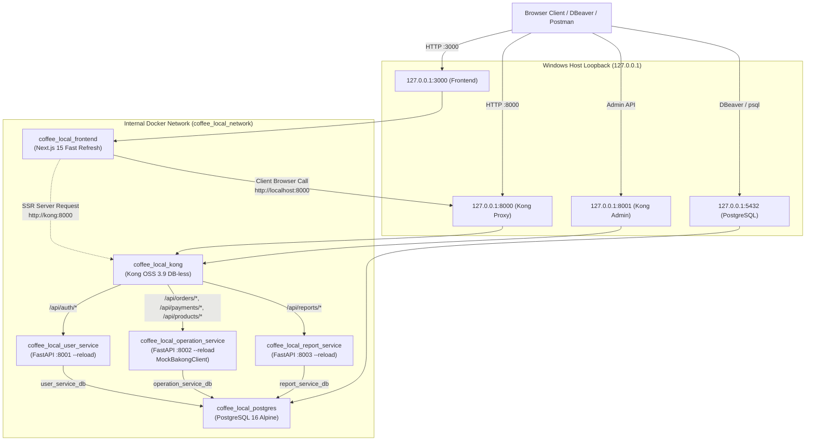

# Local Docker Desktop Development Guide (`docs/LOCAL_DOCKER_GUIDE.md`)

> **Executive Summary**: This operations runbook is the primary guide for developing, running, testing, and debugging the Coffee Shop Kong APIM platform locally on **Windows 10/11** using **Docker Desktop with the WSL2 backend** and **PowerShell**. All services (Kong Gateway, PostgreSQL 16, User Service, Operation Service, Report Service, and Next.js Frontend) start with a single command, bind strictly to loopback (`127.0.0.1`), and support instantaneous hot reload.

---

## 1. Prerequisites & Windows Host Optimization

### 1.1 Minimum System Requirements
- **OS**: Windows 10 (Build 19044+) or Windows 11 64-bit with WSL2 enabled.
- **Docker**: Docker Desktop 4.30+ with the **WSL2-based engine** enabled (`Settings > General > Use the WSL 2 based engine`).
- **RAM**: Minimum 8 GB physical RAM allocated (Recommended: 16 GB).
- **Shell**: Windows PowerShell 5.1+ or PowerShell 7 Core.

### 1.2 Recommended Docker Desktop & WSL2 Configuration
To prevent Docker and WSL2 from consuming excessive host memory, configure a `.wslconfig` file in your Windows user home directory (`$env:USERPROFILE\.wslconfig`):

```ini
[wsl2]
# Limit VM memory to avoid starving Windows
memory=6GB
# Allocate 2 to 4 virtual CPU cores
processors=4
# Avoid aggressive swap growth
swap=2GB
```

After creating or modifying `.wslconfig`, restart WSL from PowerShell:
```powershell
wsl --shutdown
```

### 1.3 Project Storage Location & Speed Tradeoff
- **Option A: Mounted Windows Drive (`D:\Study\Year-4\Python\coffee_shop`) [CURRENT]**:
  - *Advantage*: Native editing in Windows IDEs (VS Code, Cursor, PyCharm) without remote extensions.
  - *Tradeoff*: Cross-filesystem file watching (NTFS 9P mount) can delay `inotify` events. This is mitigated in our stack via polling flags: `WATCHFILES_FORCE_POLLING=true` and `WATCHPACK_POLLING=true`.
- **Option B: Native WSL2 Filesystem (`\\wsl$\Ubuntu\home\<user>\...`)**:
  - *Advantage*: Up to 5x faster disk I/O and instant kernel-level `inotify` triggers.
  - *Tradeoff*: Requires opening the project through VS Code WSL Remote extension.

### 1.4 Port Conflict Verification
Before starting the stack, verify that required loopback ports are not occupied by existing Windows background services (such as a local PostgreSQL service or IIS):

```powershell
# Check loopback ports: 8000 (Kong Proxy), 8001 (Kong Admin), 3000 (Next.js), 5432 (Postgres)
netstat -ano | findstr ":8000 :8001 :3000 :5432"
```

If any port is in use by an unwanted process:
```powershell
# Identify process name by PID (replace <PID> with the number from the last column)
Get-Process -Id <PID>

# Terminate process if safe
Stop-Process -Id <PID> -Force
```

---

## 2. First Run: Quick Start

Starting the entire stack requires only three commands in PowerShell:

```powershell
# Step 1: Navigate to repository root
cd D:\Study\Year-4\Python\coffee_shop

# Step 2: Launch the complete stack (automatically initializes .env from .env.example)
.\scripts\up.ps1

# Step 3: Run database migrations across all microservices
.\scripts\migrate.ps1
```

Once running, access the services:
- **Next.js Web Frontend**: [http://localhost:3000](http://localhost:3000)
- **Kong APIM Entry Point**: [http://localhost:8000](http://localhost:8000)
- **Kong Admin API**: [http://127.0.0.1:8001](http://127.0.0.1:8001)
- **PostgreSQL Database**: `127.0.0.1:5432` (Credentials: user `postgres`, password in `.env`)

---

## 3. Architecture & Request Flow



### Kong Ingress Route & Plugin Specification

| Route Path | Upstream Service Target | `strip_path` | HTTP Methods Allowed | Plugins Applied | Description |
| :--- | :--- | :--- | :--- | :--- | :--- |
| **`/api/auth/login`** | `http://user-service:8001/user/login` | `true` | `POST` | Rate Limiting (10/min), CORS | Login & JWT issuance (brute force protection) |
| **`/api/auth`** | `http://user-service:8001/user` | `true` | `GET, POST, PUT, PATCH, DELETE, OPTIONS` | Rate Limiting (100/min), CORS, Tracing | User registration & management |
| **`/api/orders`** | `http://operation-service:8002/order` | `true` | `GET, POST, PUT, PATCH, DELETE, OPTIONS` | Rate Limiting (100/min), CORS, Tracing | Orders & items lifecycle |
| **`/api/products`** | `http://operation-service:8002/product` | `true` | `GET, POST, PUT, DELETE, OPTIONS` | Rate Limiting (100/min), CORS, Tracing | Public catalog & product stock |
| **`/api/categories`** | `http://operation-service:8002/category` | `true` | `GET, POST, PUT, DELETE, OPTIONS` | Rate Limiting (100/min), CORS, Tracing | Menu categories |
| **`/api/payments`** | `http://operation-service:8002/payment` | `true` | `GET, POST, OPTIONS` | Rate Limiting (20/min), CORS, Tracing | Payment queries & mock triggers |
| **`/api/reports`** | `http://report-service:8003/report` | `true` | `GET, POST, OPTIONS` | Rate Limiting (100/min), CORS, Tracing | Sales analytics & snapshot sync |
| **`/health`** | `http://operation-service:8002/health` | `true` | `GET` | CORS | Primary health check & DB ping |

---

## 4. Daily Development Workflows & Commands

### 4.1 Starting and Stopping
```powershell
# Start everything in background
.\scripts\up.ps1

# Check health and status of all containers
.\scripts\ps.ps1

# Stop everything while preserving database volumes
.\scripts\down.ps1
```

### 4.2 Viewing Logs
```powershell
# View logs from all containers
.\scripts\logs.ps1

# Stream logs in real-time from Kong Gateway
.\scripts\logs.ps1 kong -Follow

# Stream logs from Operation Service (Bakong KHQR worker)
.\scripts\logs.ps1 operation-service -Follow

# Stream logs from Next.js Frontend
.\scripts\logs.ps1 frontend -Follow
```

### 4.3 Rebuilding a Single Service
When modifying Dockerfiles or dependencies:
```powershell
# Rebuild only operation-service and recreate its container
docker compose -f docker-compose.local.yml build operation-service
docker compose -f docker-compose.local.yml up -d --no-deps operation-service
```

### 4.4 Opening an Interactive Shell Inside a Container
```powershell
# Shell into user-service container
docker compose -f docker-compose.local.yml exec user-service /bin/sh

# Shell into Kong container
docker compose -f docker-compose.local.yml exec kong /bin/sh

# Shell into Next.js frontend container
docker compose -f docker-compose.local.yml exec frontend /bin/sh
```

### 4.5 Connecting to PostgreSQL
- **From Windows CLI via Docker**:
  ```powershell
  docker compose -f docker-compose.local.yml exec postgres psql -U postgres -d postgres
  ```
- **From Windows GUI (DBeaver / TablePlus / DataGrip)**:
  - **Host**: `127.0.0.1`
  - **Port**: `5432`
  - **Databases**: `user_service_db`, `operation_service_db`, `report_service_db`
  - **Username**: `postgres`
  - **Password**: Value set in `.env` (default: `postgres_local_password` or `postgres`)

---

## 5. API Testing & Mock Bakong Settlement Flow

All API operations route through **Port 8000** (Kong Gateway).

### Step 5.1: Health & Public Catalog
```powershell
# Gateway Health Check
curl.exe -i http://localhost:8000/health

# Public Product Catalog
curl.exe -s http://localhost:8000/api/products | ConvertFrom-Json
```

### Step 5.2: Register & Obtain JWT Token
```powershell
# 1. Register test user
$userBody = '{"username":"dev_tester","email":"dev_tester@coffee.kh","password":"Password123!"}'
Invoke-RestMethod -Uri "http://localhost:8000/api/auth" -Method Post -Body $userBody -ContentType "application/json"

# 2. Login
$loginBody = '{"email":"dev_tester@coffee.kh","password":"Password123!"}'
$auth = Invoke-RestMethod -Uri "http://localhost:8000/api/auth/login" -Method Post -Body $loginBody -ContentType "application/json"
$token = $auth.data.access_token
```

### Step 5.3: Create Order & Generate Dynamic Bakong KHQR
```powershell
# 1. Create order
$orderPayload = '{"items":[{"product_id":1,"quantity":2}]}'
$order = Invoke-RestMethod -Uri "http://localhost:8000/api/orders" -Method Post -Body $orderPayload -ContentType "application/json" -Headers @{"Authorization"="Bearer $token"}
$orderId = $order.data.id

# 2. Generate KHQR payment
$payPayload = '{"method":"khqr","currency":"USD"}'
$payment = Invoke-RestMethod -Uri "http://localhost:8000/api/orders/$orderId/payment" -Method Post -Body $payPayload -ContentType "application/json" -Headers @{"Authorization"="Bearer $token"}
$md5 = $payment.data.qr_md5
Write-Host "Generated KHQR with MD5: $md5 (Status: $($payment.data.status))"
```

### Step 5.4: Test Mock Settlement States
Because `BAKONG_MODE=mock`, we can simulate every payment outcome without hitting real banking APIs:

```powershell
# Outcome A: Simulate Successful Payment Settlement -> PAID
curl.exe -X POST "http://localhost:8000/api/payments/mock-pay/$md5?status=paid"

# Outcome B: Simulate QR Code Expiration -> EXPIRED
curl.exe -X POST "http://localhost:8000/api/payments/mock-pay/$md5?status=expired"

# Outcome C: Simulate Customer Bank Rejection / Insufficient Funds -> FAILED
curl.exe -X POST "http://localhost:8000/api/payments/mock-pay/$md5?status=failed"
```

---

## 6. Inspecting Kong & Declarative Reloads

### 6.1 Inspecting via Kong Admin API (Loopback: 8001)
The Admin API is bound strictly to `127.0.0.1:8001` (never exposed externally):

```powershell
# Kong Status
curl.exe -s http://127.0.0.1:8001/status | ConvertFrom-Json

# List All Active Services
curl.exe -s http://127.0.0.1:8001/services | ConvertFrom-Json

# List All Configured Ingress Routes
curl.exe -s http://127.0.0.1:8001/routes | ConvertFrom-Json

# List Enabled Plugins
curl.exe -s http://127.0.0.1:8001/plugins | ConvertFrom-Json
```

### 6.2 Modifying `kong.yml` and Live Reloading
Kong runs in DB-less mode. When you add a new route or tweak rate limiting in `kong/kong.yml`:
```powershell
# Reload configuration in running Kong container without downtime:
docker compose -f docker-compose.local.yml exec kong kong reload
```

---

## 7. Troubleshooting Guide

| Issue | Root Cause | Solution |
| :--- | :--- | :--- |
| **`Bind for 127.0.0.1:5432 failed: port is already allocated`** | Local PostgreSQL or Windows service running on port 5432. | Run `netstat -ano \| findstr :5432`, stop Windows service via `services.msc` or terminate PID. |
| **`exec format error` or `bad interpreter: /bin/bash^M`** | Windows CRLF line endings saved in Linux `.sh` shell scripts. | Ensure `.gitattributes` has `*.sh text eol=lf`. Re-save scripts with LF line endings. |
| **Container exits immediately on startup** | Configuration error, missing env var, or crash. | Check container logs: `docker compose -f docker-compose.local.yml logs <service-name>`. |
| **Database connection refused during startup** | Services attempting connection before Postgres completes initialization. | Stack enforces `depends_on: postgres: condition: service_healthy` so dependents wait until `pg_isready` passes. |
| **`CORS error: Response to preflight request doesn't pass access control check`** | Request origin does not match `http://localhost:3000` or credentials sent with wildcard `*`. | Kong CORS plugin is configured with explicit origins (`http://localhost:3000`, `http://127.0.0.1:3000`) and `credentials: true`. |
| **HTTP 502 Bad Gateway from Kong** | Upstream FastAPI microservice is stopped, crashed, or restarting. | Check `.\scripts\logs.ps1 <service>` to see the Python exception. |
| **File changes not triggering hot reload** | Windows filesystem event drops over WSL2 9P volume mount. | Enabled polling via `WATCHFILES_FORCE_POLLING=true` (FastAPI) and `WATCHPACK_POLLING=true` (Next.js). |
| **WSL2 / Vmmem consumes high RAM** | WSL2 default ballooning memory behavior. | Create `%USERPROFILE%\.wslconfig` with `memory=6GB` and run `wsl --shutdown`. |
| **Docker out of disk space (`ext4.vhdx`)** | Unused Docker build cache. | Run `docker builder prune -f`. Do **not** run destructive `volume prune`. |

---

## 8. Clean Reset and Teardown

```powershell
# Standard Teardown: Stops containers, keeps all database data
.\scripts\down.ps1

# Complete Database Reset (requires explicit confirmation):
# Drops ONLY the local volume 'coffee_local_postgres_data'
.\scripts\reset-db.ps1 -ConfirmAction
```

---

## 9. Transitioning to Cloud / EC2 Deployment
When ready to deploy this stack to a cloud VM (such as AWS EC2 Ubuntu LTS):
1. Review the archived runbook: [`docs/EC2_SETUP_GUIDE.md`](./EC2_SETUP_GUIDE.md).
2. Key differences:
   - Use `docker-compose.yml` (production multi-stage build without `--reload`).
   - Restrict Kong Admin API via SSH tunnel (`-L 8001:localhost:8001`).
   - Configure AWS Security Groups (Port 22 SSH restricted to your IP; Ports 8000 and 3000 public).
   - Generate strong production secrets (`JWT_SECRET_KEY`, `DB_PASSWORD`).
