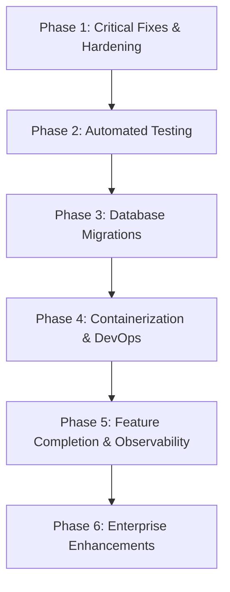

# Backend Project Status and Readiness Report

## 1. Executive Summary

The **Coffee Shop Microservices Platform** backend is a clean, well-organized prototype demonstrating microservices design principles. It features three independent FastAPI services (`user_service`, `operation_service`, `report_service`), each with dedicated PostgreSQL databases, strict database isolation, stateless JWT authentication, and transactional stock control.

### Overall Status: **Prototype / Coursework Complete; Pre-Production**

| Domain | Rating | Current State Summary |
|---|---|---|
| **Architecture & Modularity** | **A-** | Excellent database-per-service isolation, clean layered pattern (`api`/`services`/`repository`/`models`), zero direct database coupling. |
| **Business Logic Completeness** | **B+** | Core flows (auth, product CRUD, inventory row locking, order creation, payment simulation, reporting) are fully implemented. |
| **API Design & Contracts** | **A-** | Consistent `ApiResponse[T]` envelope, pagination metadata, Pydantic v2 validation. |
| **Security & Authentication** | **B** | Bcrypt hashing, stateless JWT with role claims, sentinel service tokens. Weakened by default secret fallback and absence of token revocation. |
| **Data Integrity & Concurrency** | **B+** | Strong row-level locking (`with_for_update`) for stock management; atomic rollback on order creation. Minor payment-order transaction boundary issue. |
| **Code Quality & Typing** | **B+** | Modern Python type annotations (`Mapped[...]`, Pydantic models). Minor code duplication across services. |
| **Testing & Quality Assurance** | **D** | **Zero automated tests**. Comprehensive manual `.http` test files exist. |
| **DevOps & Production Readiness** | **D** | **No Dockerfiles**, no `docker-compose.yml`, no CI/CD, no Alembic migrations, minimal logging. |

---

## 2. Feature Completion Matrix

| Feature | Service | Status | Verification Evidence / Code Reference |
|---|---|---|---|
| **User Registration** | `user_service` | ✅ Complete | `UserService.create_user`: email uniqueness check, bcrypt hash, default `customer` role. |
| **User Login & Token Issuance**| `user_service` | ✅ Complete | `UserService.authenticate` + `issue_token_for`: bcrypt check, JWT generation with `sub`, `email`, `role`. |
| **User Profile Management** | `user_service` | ✅ Complete | `GET /user/me`, `PUT /user/{id}`, `PATCH /user/{id}/password`. |
| **Role-Based Access Control** | All services | ✅ Complete | `dependencies/auth.py`: `require_roles("admin", "staff")`. Local token verification in all services. |
| **Soft Delete User** | `user_service` | ✅ Complete | `user_repository.soft_delete`: sets `deleted_at=now()` and `is_active=False`. Queries filter `deleted_at IS NULL`. |
| **Menu / Product Catalog** | `operation_service`| ✅ Complete | `ProductService.add_product`, `list_products`, `update_product`, `deactivate`. Public read with pagination. |
| **Inventory Choke Point** | `operation_service`| ✅ Complete | `StockService`: all mutations (`increase`, `decrease`, `adjust`) flow through this single class. |
| **Stock Movement Audit Log** | `operation_service`| ✅ Complete | `StockMovement` append-only table records `change_quantity`, `quantity_after`, `reason`, `reference`. |
| **Order Creation (Atomic)** | `operation_service`| ✅ Complete | `OrderService.create_order`: row-level lock (`with_for_update`), decrements stock, records items, atomic rollback. |
| **Order State Machine** | `operation_service`| ✅ Complete | `OrderStatus.TRANSITIONS`: strictly enforces allowed transitions (`pending` → `paid`/`cancelled`, `paid` → `completed`/`cancelled`). |
| **Order Cancellation Restock** | `operation_service`| ✅ Complete | `OrderService.update_status`: automatically increments product stock when order is cancelled. |
| **Payment Processing** | `operation_service`| ✅ Complete (Simulated)| `PaymentService.pay_for_order`: charges simulated gateway, creates payment record, moves order to `paid`. |
| **Service Account Auth** | `report_service` | ✅ Complete | `create_service_token()` mints short-lived JWT (`sub="report_service"`, `role="admin"`) to authenticate sync calls. |
| **Data Synchronization** | `report_service` | ✅ Complete | `SyncService`: paginated HTTP pulls from `user_service` & `operation_service`, upserting into local snapshot tables. |
| **Sales Summary Analytics** | `report_service` | ✅ Complete | `ReportService.sales_summary`: computes revenue, order counts, and average order value across date ranges. |
| **Daily Sales Breakdown** | `report_service` | ✅ Complete | `ReportService.daily_sales`: SQL aggregation grouping revenue and order counts by calendar day. |
| **Top Products Report** | `report_service` | ✅ Complete | `ReportService.top_products`: joins `OrderSnapshot` and `OrderItemSnapshot`, ordered by quantity sold. |
| **Inventory Low-Stock Alerts** | `report_service` | ✅ Complete | `ReportService.low_stock_alerts`: queries active products with stock below threshold. |
| **User Demographics Report** | `report_service` | ✅ Complete | `ReportService.user_summary`: total, active, inactive users, new signups, and breakdown by role. |
| **Stock Movement History API** | `operation_service`| ⚠️ Partial | `stock_repository.get_movements_for_product` is implemented, but no API router endpoint exposes it. |
| **Automatic Scheduled Sync** | `report_service` | ⚠️ Partial | Sync executes once on startup (best effort); subsequent syncs require manual `POST /report/sync` calls. |
| **Automated Testing Suite** | All services | ❌ Not Implemented | Zero unit or integration test files. |
| **Alembic DB Migrations** | All services | ❌ Not Implemented | Installed in `requirements.txt` but uninitialized. Relies on `create_all()`. |
| **Docker / Containerization** | All services | ❌ Not Implemented | No Dockerfile or docker-compose files exist. |
| **Real Payment Gateway** | `operation_service`| ❌ Not Implemented | Uses simulated `_charge()` generating `SIM-<method>-<hex>` tokens. |
| **Refresh Tokens / Revocation**| All services | ❌ Not Implemented | Access tokens cannot be revoked prior to expiry. |

---

## 3. Production Readiness Assessment

### Current Verdict: **NOT PRODUCTION READY**

While the functional logic is complete and architectural patterns are solid, the platform cannot be safely deployed to a mission-critical production environment without addressing the following foundational gaps:

1. **Security Vulnerability:** Insecure default `JWT_SECRET_KEY` fallback (`"change-me-in-production"`).
2. **Schema Integrity:** Reliance on `Base.metadata.create_all()` prevents production database schema updates without manual SQL intervention.
3. **Reliability & Regression Risk:** Complete absence of automated tests (`pytest`) means regressions cannot be detected during deployments.
4. **Configuration Issue:** Path mismatch for `user_service/app/.env` prevents standard startup from the service root.
5. **Observability:** Missing structured logging in `user_service` and `operation_service`.

---

## 4. Recommended Implementation Sequence for Future Work

The following phased roadmap outlines the exact sequence for taking this backend to production readiness:

### Phase 1: Critical Fixes & Security Hardening (Immediate)
1. **Fix `user_service` `.env` path:** Move `user_service/app/.env` and `.env.example` to `user_service/.env` to match the other services.
2. **Eliminate Default JWT Secret Fallback:** Remove `"change-me-in-production"` defaults in all `config.py` files. Ensure application startup aborts with an explicit error if `JWT_SECRET_KEY` is undefined.
3. **Restrict Profile Updates:** Remove `is_active` from `UpdateUserRequest` so standard users cannot deactivate or modify account state.
4. **Standardize Validation Error Responses:** Add a global `RequestValidationError` handler in `exception_handler.py` across all services to format Pydantic 422 errors into the `ApiResponse` envelope.

### Phase 2: Automated Testing Suite
1. Add `pytest`, `pytest-asyncio`, and `httpx` to `requirements.txt`.
2. Implement unit tests for `StockService`, `OrderService`, and `UserService`.
3. Implement integration tests using FastAPI's `TestClient` for all 21 API endpoints.
4. Add concurrent order creation tests to verify row-level locking (`with_for_update`) prevents stock overselling.

### Phase 3: Database Migrations (Alembic)
1. Run `alembic init` for each service database (`user_service`, `operation_service`, `report_service`).
2. Generate baseline revision scripts from current SQLAlchemy declarative models.
3. Remove `Base.metadata.create_all()` from all `app/main.py` startup files.
4. Add missing indexes (e.g. `orders(user_id, status)`, `OrderSnapshot.created_at`).

### Phase 4: Containerization & Local Development Stack
1. Create a production-grade multi-stage `Dockerfile`.
2. Create a unified `docker-compose.yml` defining the three FastAPI services and a PostgreSQL 16 container pre-provisioned with the three databases.
3. Add an NGINX or Traefik reverse proxy container acting as an API Gateway on port 80/443.

### Phase 5: Feature Completion & Observability
1. **Expose Stock Movement History API:** Add `GET /product/{id}/stock-movements` endpoint in `operation_service/app/api/product_route.py`.
2. **Implement Structured Logging:** Add Python `logging` configuration with JSON formatting and request ID middleware to all services.
3. **Background Sync Worker:** Wire `report_service` sync into a scheduled periodic job (using APScheduler or Celery) rather than relying solely on manual trigger or startup sync.

### Phase 6: Enterprise Enhancements (Long-Term)
1. **Event-Driven Sync:** Replace HTTP polling sync with an event broker (RabbitMQ / Apache Kafka) to broadcast order and product events in real time.
2. **Real Payment Gateway:** Implement Stripe / PayPal webhooks and SDK integration in `PaymentService`.
3. **Redis Token Revocation:** Introduce Redis for JWT blacklisting and refresh token rotation.
