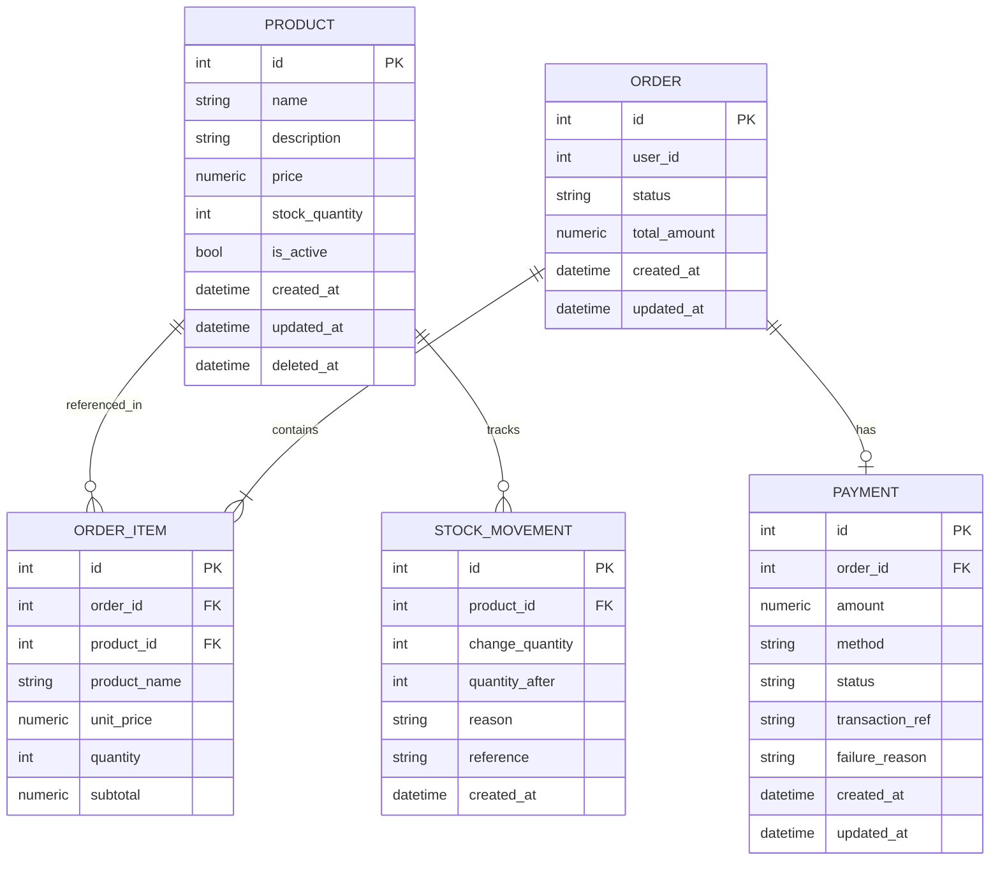
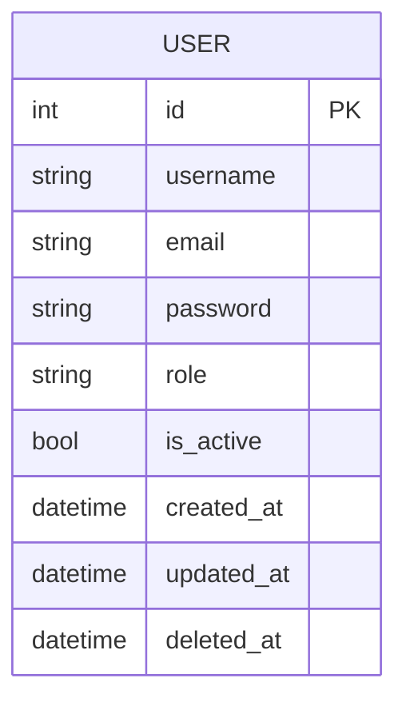
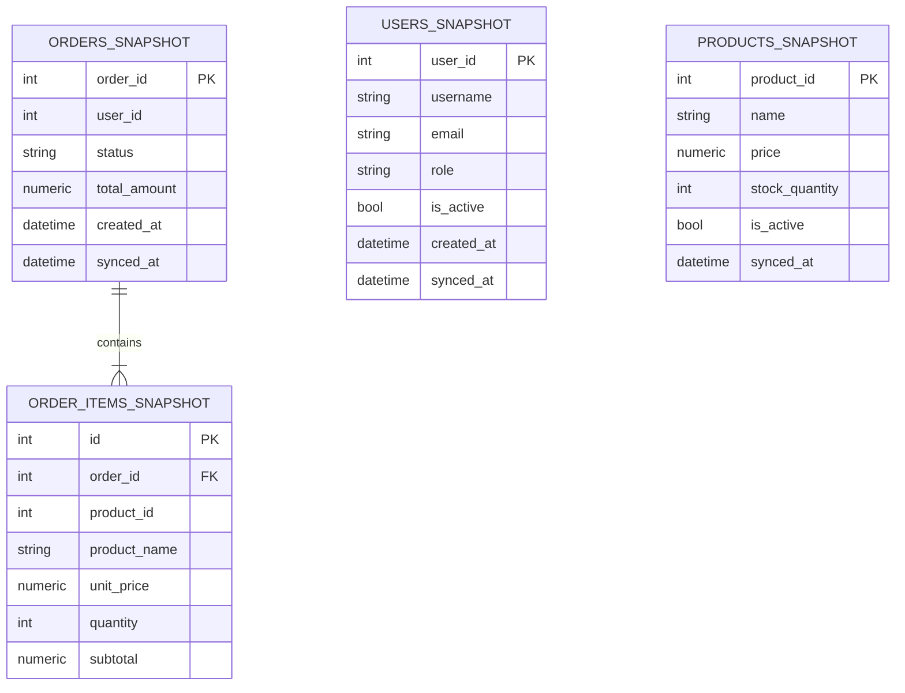

# Database Analysis

## Database Configuration

All three services use the same ORM and driver stack but connect to separate databases.

| Property | Value |
|---|---|
| Database engine | PostgreSQL |
| ORM | SQLAlchemy 2.0.51 |
| ORM session style | Synchronous (classic `Session` / `SessionLocal`) |
| Query style | Legacy `db.query()` ORM API (not `select()` 2.0 style) |
| Driver | `psycopg2-binary 2.9.12` |
| Connection string pattern | `postgresql+psycopg2://<user>:<password>@<host>:<port>/<db>` |
| Connection pool | `pool_pre_ping=True` (validates connections before use) |
| Autocommit | `False` |
| Autoflush | `False` |
| Schema creation | `Base.metadata.create_all(bind=engine)` at startup |
| Migrations | **Not implemented** — Alembic is installed but unconfigured |
| Naming strategy | SQLAlchemy default (snake_case, no customization) |
| Session lifecycle | Per-request generator in `dependencies/db.py` (`get_db`) |

### Connection Configuration (per service)

Environment variables loaded by `python-dotenv`:

| Variable | Purpose |
|---|---|
| `DB_HOST` | PostgreSQL host |
| `DB_PORT` | PostgreSQL port (default: 5432) |
| `DB_NAME` | Database name |
| `DB_USER` | Database user |
| `DB_PASSWORD` | Database password *(never exposed in docs)* |

### Databases

| Service | Database Name |
|---|---|
| user_service | `user_service_db` |
| operation_service | `operation_service_db` |
| report_service | `report_service_db` |

---

## Entity Inventory

### user_service_db

#### Entity: `User`

| Property | Value |
|---|---|
| **Entity name** | `User` |
| **File** | `user_service/app/models/user.py` |
| **Table name** | `users` |
| **Purpose** | Stores all registered user accounts; source of truth for identity and roles |
| **Primary key** | `id` (Integer, autoincrement) |
| **Foreign keys** | None (isolated database) |

| Column | Type | Nullable | Default | Notes |
|---|---|---|---|---|
| `id` | Integer | No | autoincrement | PK |
| `username` | String(255) | No | — | Display name |
| `email` | String(255) | No | — | Unique, indexed |
| `password` | String(255) | No | — | bcrypt hash |
| `role` | String(50) | No | `"customer"` | `customer`, `staff`, or `admin` |
| `is_active` | Boolean | No | `True` | Soft-delete flag |
| `created_at` | DateTime | No | `datetime.now` | Not timezone-aware |
| `updated_at` | DateTime | No | `datetime.now` | Updated on every save |
| `deleted_at` | DateTime | Yes | `NULL` | Set on soft delete |

**Indexes:** `email` (unique index), `id` (PK implicit index)  
**Constraints:** `email` UNIQUE  
**Relationships:** None (single-table service)  
**Soft delete:** `deleted_at IS NOT NULL` → excluded from all queries; `is_active` also set to `False`

---

### operation_service_db

#### Entity: `Product`

| Property | Value |
|---|---|
| **Entity name** | `Product` |
| **File** | `operation_service/app/models/product.py` |
| **Table name** | `products` |
| **Purpose** | Coffee shop menu items with pricing and stock tracking |
| **Primary key** | `id` (Integer, autoincrement) |
| **Foreign keys** | None |

| Column | Type | Nullable | Default | Notes |
|---|---|---|---|---|
| `id` | Integer | No | autoincrement | PK |
| `name` | String(255) | No | — | Unique, indexed |
| `description` | String(1000) | Yes | `NULL` | Optional detail |
| `price` | Numeric(10,2) | No | — | Must be > 0 (enforced in schema) |
| `stock_quantity` | Integer | No | `0` | Managed only through StockService |
| `is_active` | Boolean | No | `True` | Soft-delete / availability flag |
| `created_at` | DateTime | No | `datetime.now` | — |
| `updated_at` | DateTime | No | `datetime.now` | onupdate set |
| `deleted_at` | DateTime | Yes | `NULL` | Soft delete marker |

**Indexes:** `name` (unique), `id` (PK)  
**Constraints:** `name` UNIQUE

---

#### Entity: `Order`

| Property | Value |
|---|---|
| **Entity name** | `Order` |
| **File** | `operation_service/app/models/order.py` |
| **Table name** | `orders` |
| **Purpose** | Tracks customer orders through their lifecycle |
| **Primary key** | `id` (Integer, autoincrement) |
| **Foreign keys** | None to users table (cross-service; `user_id` is JWT claim only) |

| Column | Type | Nullable | Default | Notes |
|---|---|---|---|---|
| `id` | Integer | No | autoincrement | PK |
| `user_id` | Integer | No | — | Indexed; JWT `sub` claim — no FK to `users` |
| `status` | String(20) | No | `"pending"` | `pending`, `paid`, `cancelled`, `completed` |
| `total_amount` | Numeric(10,2) | No | `0` | Computed from items at creation |
| `created_at` | DateTime | No | `datetime.now` | — |
| `updated_at` | DateTime | No | `datetime.now` | onupdate set |

**Relationships:**
- `items` → `OrderItem` (one-to-many, `cascade="all, delete-orphan"`, `lazy="selectin"`)
- `payment` → `Payment` (one-to-one, `uselist=False`, `cascade="all, delete-orphan"`, `lazy="selectin"`)

**Status transitions (enforced in code):**
```
pending → paid | cancelled
paid    → completed | cancelled
cancelled → (terminal, no transitions)
completed → (terminal, no transitions)
```

---

#### Entity: `OrderItem`

| Property | Value |
|---|---|
| **Entity name** | `OrderItem` |
| **File** | `operation_service/app/models/order.py` |
| **Table name** | `order_items` |
| **Purpose** | Individual line items within an order; price/name snapshotted at order time |
| **Primary key** | `id` (Integer, autoincrement) |
| **Foreign keys** | `order_id` → `orders.id` (ON DELETE CASCADE); `product_id` → `products.id` |

| Column | Type | Nullable | Default | Notes |
|---|---|---|---|---|
| `id` | Integer | No | autoincrement | PK |
| `order_id` | Integer | No | — | FK → orders.id, indexed |
| `product_id` | Integer | No | — | FK → products.id, indexed (no cascade) |
| `product_name` | String(255) | No | — | Price snapshot at order time |
| `unit_price` | Numeric(10,2) | No | — | Snapshot at order time |
| `quantity` | Integer | No | — | Must be > 0 |
| `subtotal` | Numeric(10,2) | No | — | `unit_price × quantity` |

**Relationships:** `order` → `Order` (many-to-one, back-populates `items`)

> [!NOTE]
> `product_id` has an index but **no ON DELETE rule** specified — if a product row were hard-deleted (which never happens in practice; only soft-delete is used), the FK would be violated.

---

#### Entity: `Payment`

| Property | Value |
|---|---|
| **Entity name** | `Payment` |
| **File** | `operation_service/app/models/payment.py` |
| **Table name** | `payments` |
| **Purpose** | Records payment attempt(s) for an order; simulated gateway |
| **Primary key** | `id` (Integer, autoincrement) |
| **Foreign keys** | `order_id` → `orders.id` (ON DELETE CASCADE) |

| Column | Type | Nullable | Default | Notes |
|---|---|---|---|---|
| `id` | Integer | No | autoincrement | PK |
| `order_id` | Integer | No | — | FK, UNIQUE, indexed (one payment per order) |
| `amount` | Numeric(10,2) | No | — | Copied from `order.total_amount` |
| `method` | String(20) | No | — | `cash`, `card`, `e_wallet` |
| `status` | String(20) | No | `"pending"` | `pending`, `success`, `failed` |
| `transaction_ref` | String(64) | No | — | Simulated gateway ref `SIM-<METHOD>-<hex>` |
| `failure_reason` | String(255) | Yes | `NULL` | Populated only on failure |
| `created_at` | DateTime | No | `datetime.now` | — |
| `updated_at` | DateTime | No | `datetime.now` | onupdate set |

**Relationships:** `order` → `Order` (many-to-one, back-populates `payment`)

---

#### Entity: `StockMovement`

| Property | Value |
|---|---|
| **Entity name** | `StockMovement` |
| **File** | `operation_service/app/models/stock_movement.py` |
| **Table name** | `stock_movements` |
| **Purpose** | Append-only ledger of every stock change; enables full auditability |
| **Primary key** | `id` (Integer, autoincrement) |
| **Foreign keys** | `product_id` → `products.id` (no cascade specified) |

| Column | Type | Nullable | Default | Notes |
|---|---|---|---|---|
| `id` | Integer | No | autoincrement | PK |
| `product_id` | Integer | No | — | FK, indexed |
| `change_quantity` | Integer | No | — | Positive = added, negative = removed |
| `quantity_after` | Integer | No | — | Stock level after this change |
| `reason` | String(30) | No | — | `restock`, `sale`, `cancellation`, `adjustment` |
| `reference` | String(255) | Yes | `NULL` | e.g. `"order#12"` or `"supplier delivery #45"` |
| `created_at` | DateTime | No | `datetime.now` | Immutable after creation |

> [!NOTE]
> `StockMovement` has **no `updated_at`** and is intentionally never modified after creation — it is an append-only audit log.

---

### report_service_db

All tables are disposable snapshots rebuilt via `POST /report/sync`.

#### Entity: `UserSnapshot`

| Property | Value |
|---|---|
| **Table name** | `users_snapshot` |
| **Purpose** | Local denormalized copy of user_service users for reporting |
| **Primary key** | `user_id` (same as user_service `users.id`, not autoincrement) |

| Column | Type | Notes |
|---|---|---|
| `user_id` | Integer PK | Mirrors `users.id` |
| `username` | String(255) | — |
| `email` | String(255) | — |
| `role` | String(50) | — |
| `is_active` | Boolean | — |
| `created_at` | DateTime | Original creation timestamp |
| `synced_at` | DateTime | When this row was last synced |

> [!NOTE]
> No `password` column — snapshot intentionally excludes sensitive fields.

---

#### Entity: `ProductSnapshot`

| Property | Value |
|---|---|
| **Table name** | `products_snapshot` |
| **Primary key** | `product_id` |

| Column | Type | Notes |
|---|---|---|
| `product_id` | Integer PK | Mirrors `products.id` |
| `name` | String(255) | — |
| `price` | Numeric(10,2) | — |
| `stock_quantity` | Integer | — |
| `is_active` | Boolean | — |
| `synced_at` | DateTime | — |

---

#### Entity: `OrderSnapshot`

| Property | Value |
|---|---|
| **Table name** | `orders_snapshot` |
| **Primary key** | `order_id` |

| Column | Type | Notes |
|---|---|---|
| `order_id` | Integer PK | Mirrors `orders.id` |
| `user_id` | Integer | No FK (cross-service reference) |
| `status` | String(20) | — |
| `total_amount` | Numeric(10,2) | — |
| `created_at` | DateTime | Original order creation time |
| `synced_at` | DateTime | — |

**Relationships:** `items` → `OrderItemSnapshot` (one-to-many, `cascade="all, delete-orphan"`, `lazy="selectin"`)

---

#### Entity: `OrderItemSnapshot`

| Property | Value |
|---|---|
| **Table name** | `order_items_snapshot` |
| **Primary key** | `id` (autoincrement, local surrogate) |

| Column | Type | Notes |
|---|---|---|
| `id` | Integer PK | Local autoincrement |
| `order_id` | Integer | FK → `orders_snapshot.order_id` ON DELETE CASCADE, indexed |
| `product_id` | Integer | No FK (cross-service) |
| `product_name` | String(255) | — |
| `unit_price` | Numeric(10,2) | — |
| `quantity` | Integer | — |
| `subtotal` | Numeric(10,2) | — |

---

## Entity Relationship Diagram

### operation_service_db



### user_service_db



### report_service_db



---

## Database Issues and Risks

### Confirmed Issues

| # | Issue | Affected File | Explanation |
|---|---|---|---|
| 1 | **No Alembic migrations** | All 3 services `main.py` | `create_all()` cannot safely ALTER existing tables; schema drift is undetectable in production |
| 2 | **Naive datetimes** | All models `created_at`, `updated_at` | `datetime.now` (no timezone) stores local time; can cause reporting bugs across timezones |
| 3 | **No hard constraint on role values** | `users` table | `role` is free-text String(50); only enforced at the Pydantic layer (`UpdateUserRoleRequest`) |
| 4 | **No hard constraint on order status** | `orders` table | `status` is free-text String(20); only validated in `OrderStatus.TRANSITIONS` dict |
| 5 | **`product_id` FK in `order_items` has no ON DELETE rule** | `operation_service/app/models/order.py` L55 | A hypothetical hard-delete of a product would violate the FK |
| 6 | **`product_id` FK in `stock_movements` has no cascade** | `operation_service/app/models/stock_movement.py` L24 | Same risk as above |

### Potential Improvements

| # | Issue | Explanation |
|---|---|---|
| 1 | Missing `CHECK` constraints | `stock_quantity >= 0`, `price > 0`, `quantity > 0` not enforced at DB level |
| 2 | Missing composite index on `orders(user_id, status)` | Frequently filtered together in `order_repository.get_all` |
| 3 | `stock_movements` grows unboundedly | No archival or partitioning strategy |
| 4 | `count_all()` + `get_all()` pattern | Two queries per paginated list; could use window function or subquery |
| 5 | `report_service` snapshot tables have no `deleted_at` equivalent | Soft-deleted users/products in source services remain in snapshots as `is_active=False` but are never removed |
