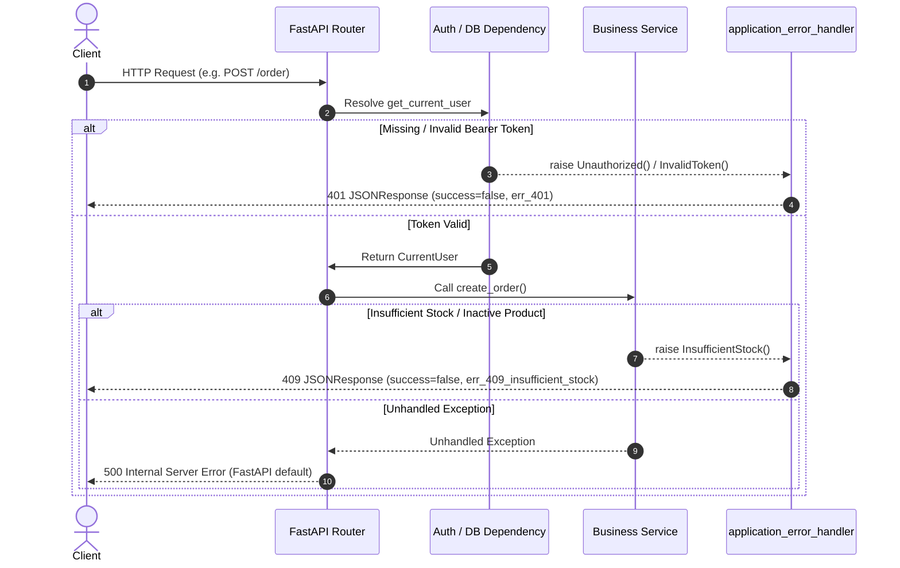

# Error Handling and Performance Analysis

## 1. Error Handling Architecture

The Coffee Shop backend implements a custom exception handling hierarchy designed to standardize error payloads across all three microservices.

### 1.1 Custom Exception Hierarchy

Every custom application exception inherits from `ApplicationError` defined in `app/core/exception.py` in each service.

```
ApplicationError (Exception)
│   ├── message: str
│   ├── error_code: str
│   └── status_code: int
│
├── user_service:
│   ├── UserNotFound (404, "err_404")
│   ├── EmailAlreadyExists (409, "err_409")
│   ├── Unauthorized (401, "err_401")
│   ├── Forbidden (403, "err_403")
│   ├── InvalidCredentials (401, "err_401_invalid_credentials")
│   ├── InvalidToken (401, "err_401_invalid_token")
│   ├── TokenExpired (401, "err_401_token_expired")
│   └── InactiveUser (403, "err_403_inactive_user")
│
├── operation_service:
│   ├── Unauthorized (401, "err_401")
│   ├── Forbidden (403, "err_403")
│   ├── InvalidToken (401, "err_401_invalid_token")
│   ├── TokenExpired (401, "err_401_token_expired")
│   ├── ProductNotFound (404, "err_404_product")
│   ├── ProductNameAlreadyExists (409, "err_409_product_name")
│   ├── ProductInactive (409, "err_409_product_inactive")
│   ├── InsufficientStock (409, "err_409_insufficient_stock")
│   ├── InvalidStockAdjustment (400, "err_400_stock_adjustment")
│   ├── OrderNotFound (404, "err_404_order")
│   ├── EmptyOrder (400, "err_400_empty_order")
│   ├── InvalidOrderStatusTransition (409, "err_409_order_status")
│   ├── PaymentAlreadyExists (409, "err_409_payment_exists")
│   ├── PaymentNotFound (404, "err_404_payment")
│   ├── OrderNotPayable (409, "err_409_order_not_payable")
│   └── PaymentFailed (402, "err_402_payment_failed")
│
└── report_service:
    ├── Unauthorized (401, "err_401")
    ├── Forbidden (403, "err_403")
    ├── InvalidToken (401, "err_401_invalid_token")
    ├── TokenExpired (401, "err_401_token_expired")
    ├── InvalidDateRange (400, "err_400_date_range")
    └── SyncFailed (502, "err_502_sync_failed")
```

### 1.2 Global Exception Handlers

All three services register `application_error_handler` on the FastAPI application instance in `app/main.py`:

```python
app.add_exception_handler(ApplicationError, application_error_handler)
```

**Handler Implementation (`app/core/exception_handler.py`):**
```python
async def application_error_handler(request: Request, exception: ApplicationError):
    return JSONResponse(
        status_code=exception.status_code,
        content={
            "success": False,
            "error_code": exception.error_code,
            "message": exception.message,
            "data": None,
        },
    )
```

### 1.3 Error Handling Flow



### 1.4 Error Handling Inconsistencies and Gaps

| Error Category | Handling Mechanism | Response Format | Status / Concern |
|---|---|---|---|
| `ApplicationError` | Handled by `application_error_handler` | Envelope: `{"success": false, "error_code": "...", "message": "...", "data": null}` | ✅ Uniform and consistent |
| Pydantic `RequestValidationError` | Handled by FastAPI default handler | Default FastAPI schema: `{"detail": [{"loc": [...], "msg": "...", "type": "..."}]}` | ⚠️ Inconsistent envelope; bypasses `ApiResponse` format |
| Starlette `HTTPException` | Handled by Starlette/FastAPI default | Default format: `{"detail": "..."}` | ⚠️ Inconsistent format |
| Unhandled Exceptions (500) | Handled by Starlette default | Text: `Internal Server Error` (500) | ⚠️ No logging, no stacktrace capture, no uniform JSON response |
| Database `IntegrityError` | Uncaught in repositories | Propagates to 500 Unhandled Exception | ⚠️ Potential leakage of raw SQL errors if debug mode enabled |

---

## 2. Logging Architecture

### 2.1 Logging Analysis Across Services

| Service | Logging Configured? | Logger Name | Usage |
|---|---|---|---|
| `user_service` | ❌ No | None | No logging calls anywhere in `api/`, `services/`, `repository/`, or `core/` |
| `operation_service` | ❌ No | None | No logging calls anywhere |
| `report_service` | ⚠️ Minimal | `logging.getLogger("report_service")` | Only 2 log calls in `app/main.py` (`_sync_on_startup` info/warning). Zero logs in `api/`, `services/`, or `repository/` |

### 2.2 Logging Deficiencies

1. **No Structured Logging:** None of the services configure JSON or structured log formatters.
2. **No Distributed Request Tracing:** Requests lack `X-Request-ID` or `trace_id` correlation headers across services.
3. **Silent Failures:** Errors caught inside `try/except` blocks (such as in `OrderService.create_order` or `PaymentService.pay_for_order`) rollback the transaction and re-raise without writing error logs.
4. **Audit Trail Limitations:** While stock movements are recorded in the `stock_movements` table, security events (failed logins, role changes, user deactivations) produce zero log entries.

---

## 3. Database Query & Performance Analysis

### 3.1 SQLAlchemy Query Patterns

All three services use synchronous SQLAlchemy 2.0.51 with the `psycopg2-binary` driver.

| Metric / Pattern | Implementation Status | Notes |
|---|---|---|
| **Query Style** | Legacy 1.x `db.query(Model)` | Works in SQLAlchemy 2.0 but deprecated in favor of `select(Model)` |
| **Session Lifecycle** | `dependencies/db.py` generator | Standard `try ... yield db finally: db.close()` pattern |
| **Connection Pooling** | `pool_pre_ping=True` | Actively prevents stale connection drops from PostgreSQL |
| **Autocommit / Autoflush** | `autocommit=False, autoflush=False` | Manual transaction control enabled |

### 3.2 Concurrency and Row-Level Locking

In `operation_service/app/repository/product_repository.py`:

```python
def get_by_id_for_update(db: Session, product_id: int):
    """Row-level lock so concurrent orders can't oversell the same stock."""
    return (
        db.query(Product)
        .filter(Product.id == product_id, Product.deleted_at.is_(None))
        .with_for_update()
        .first()
    )
```

**Evaluation:**
- ✅ **Race Condition Prevention:** Using `SELECT ... FOR UPDATE` during order creation locks the product row until the order transaction commits. This prevents classic double-spending / overselling of limited inventory under concurrent checkout requests.
- ⚠️ **Lock Contention:** If multiple orders contain high-demand items (e.g. popular coffee blends), transactions will queue sequentially on those product rows. Transactions must be kept short to minimize lock hold duration.

### 3.3 Eager Loading & N+1 Query Prevention

In `operation_service/app/models/order.py`:
```python
items: Mapped[list["OrderItem"]] = relationship(
    back_populates="order", cascade="all, delete-orphan", lazy="selectin"
)
payment: Mapped["Payment | None"] = relationship(
    back_populates="order", uselist=False, cascade="all, delete-orphan", lazy="selectin"
)
```

**Evaluation:**
- ✅ `lazy="selectin"` instructs SQLAlchemy to load all related `order_items` and `payment` rows using `SELECT ... WHERE order_id IN (...)`.
- This avoids the N+1 query problem when listing multiple orders in `GET /order`.
- The same `lazy="selectin"` strategy is correctly applied in `OrderSnapshot.items` in `report_service`.

### 3.4 Pagination Query Performance

All paginated endpoints (`GET /user`, `GET /product`, `GET /order`) execute two sequential database queries:
1. `count_all(db)` → `SELECT count(*) FROM <table> WHERE deleted_at IS NULL`
2. `get_all(db, skip, limit)` → `SELECT * FROM <table> WHERE deleted_at IS NULL ORDER BY id LIMIT 20 OFFSET 0`

**Evaluation:**
- Offset-based pagination (`OFFSET skip LIMIT limit`) degrades in performance as `page` grows large on massive tables.
- For coursework / medium-scale volume, this is acceptable, but keyset/cursor pagination is recommended for enterprise scale.

### 3.5 Database Index Analysis

| Table | Indexed Columns | Missing Recommended Indexes |
|---|---|---|
| `users` | `id` (PK), `email` (UNIQUE) | Composite index on `(deleted_at, id)` for paginated user list |
| `products` | `id` (PK), `name` (UNIQUE) | Index on `(is_active, deleted_at)` for filtered product catalog |
| `orders` | `id` (PK), `user_id` | Composite index on `(user_id, status)` for filtered user order history; index on `created_at` |
| `order_items` | `id` (PK), `order_id`, `product_id` | Fully indexed |
| `payments` | `id` (PK), `order_id` (UNIQUE) | Fully indexed |
| `stock_movements` | `id` (PK), `product_id` | Index on `created_at` for chronological stock auditing |
| `users_snapshot` | `user_id` (PK) | Index on `created_at` and `role` used heavily in `report_service` queries |
| `products_snapshot` | `product_id` (PK) | Index on `(is_active, stock_quantity)` for low-stock alerts |
| `orders_snapshot` | `order_id` (PK) | Index on `(created_at, status)` used in revenue and daily sales aggregation |
| `order_items_snapshot`| `id` (PK), `order_id` | Composite index on `(product_id, quantity)` for top-product queries |

---

## 4. Asynchronous vs. Synchronous Programming Analysis

### 4.1 Route Handler Threading Model

FastAPI handles `async def` and synchronous `def` endpoints differently:
- **`async def` endpoints:** Execute directly on the asyncio event loop. Any blocking I/O (such as `time.sleep()`, synchronous DB drivers like `psycopg2`, or blocking HTTP requests) freezes the entire server worker!
- **`def` (sync) endpoints:** FastAPI automatically runs sync functions inside a separate worker thread managed by `anyio.to_thread.run_sync()`.

**Inspection Findings in Codebase:**
- In `user_service/app/api/user_route.py`: All 9 endpoints are declared as `def` (sync).
- In `operation_service/app/api/product_route.py`, `order_route.py`, `payment_route.py`: All endpoints are declared as `def` (sync).
- In `report_service/app/api/report_route.py`: All endpoints are declared as `def` (sync).
- Root endpoints `GET /` in `operation_service` and `report_service` are declared as `async def root(): return {...}` which is non-blocking.

**Evaluation:**
- ✅ **Architectural Soundness:** Because the project uses synchronous SQLAlchemy with `psycopg2-binary`, declaring endpoints as `def` is the **correct pattern**. It prevents blocking the main event loop.
- ⚠️ **Threadpool Saturation Risk:** Under high concurrency, synchronous threadpool workers can be exhausted if database queries or external sync HTTP requests take too long.

### 4.2 Report Service HTTP Sync Performance

In `report_service/app/services/sync_service.py`:
- `SyncService._paginate` uses synchronous `httpx.Client(base_url=..., timeout=10.0)` in a context manager.
- It iterates through pages of `user_service` and `operation_service`.
- For each item, it executes `db.get(...)` followed by `db.add(...)`.
- This creates an **O(N) single-item lookup and upsert pattern**:

```python
for u in self._paginate(settings.USER_SERVICE_BASE_URL, "/user"):
    existing = db.get(UserSnapshot, u["id"]) # Single SELECT per item
    if existing:
        ...
    else:
        db.add(...)
```

**Evaluation:**
- For 100 users, 500 products, and 1,000 orders, this executes over 1,600 individual `SELECT` queries across the network to PostgreSQL during sync!
- **Recommended Optimization:** Replace row-by-row lookups with PostgreSQL bulk upsert:
  `INSERT INTO products_snapshot (...) VALUES (...) ON CONFLICT (product_id) DO UPDATE SET ...`
