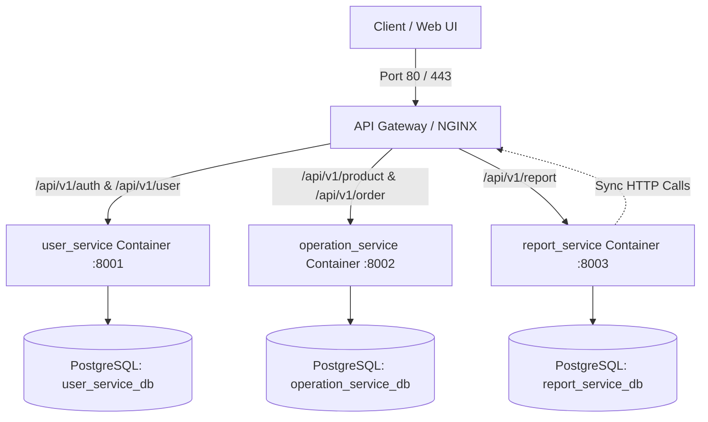

# Testing and Deployment Analysis

## 1. Testing Architecture & Current Status

### 1.1 Automated Testing Inventory

A comprehensive inspection of the entire codebase confirmed:

| Test Category | Implementation Status | Test Count | Location |
|---|---|---|---|
| Unit Tests | ❌ Not Implemented | 0 | No `test_*.py` files in project |
| Integration Tests | ❌ Not Implemented | 0 | No integration suites or test DB fixtures |
| API / Route Tests | ❌ Not Implemented | 0 | No `TestClient` or `pytest-asyncio` suites |
| Database Tests | ❌ Not Implemented | 0 | No isolated rollback fixtures or migrations |
| Security / Auth Tests | ❌ Not Implemented | 0 | No automated role verification tests |
| **Manual HTTP Test Suites** | ✅ **Implemented** | 3 files | `*.http` client files |

> [!WARNING]
> There are **zero automated Python tests** (`pytest` or `unittest`) in this repository. All quality verification is currently performed manually using HTTP client test files.

---

### 1.2 Manual HTTP Test Suites

Each service includes a `test_main.http` file compatible with the VS Code REST Client extension and JetBrains HTTP Client.

#### 1.2.1 `user_service/app/test_main.http` (88 lines)

Covers the full authentication lifecycle:
1. `POST /user`: Register new customer (`alice@example.com`).
2. `POST /user/login`: Authenticate and acquire JWT token.
3. `GET /user/me`: Retrieve current profile using Bearer token.
4. `GET /user?page=1&page_size=20`: List users (verifies 403 Forbidden for non-admin/staff).
5. `GET /user/1`: Get user by ID (self or admin).
6. `PUT /user/1`: Update username and email.
7. `PATCH /user/1/password`: Change password with verification of old password.
8. `POST /user/login` (negative test): Wrong password triggering `401 InvalidCredentials`.
9. `GET /user/me` (negative test): Missing token triggering `401 Unauthorized`.

#### 1.2.2 `operation_service/test_main.http` (123 lines)

Covers menu management, stock, ordering, and payments:
1. `POST /product`: Add new product (admin/staff token).
2. `GET /product?page=1&page_size=10&active_only=true`: Public menu listing.
3. `GET /product/1`: Public product lookup.
4. `PUT /product/1`: Update product price/description.
5. `POST /product/1/stock`: Manual restock adjustment.
6. `POST /order`: Create order with atomic inventory decrement.
7. `GET /order?page=1&page_size=10`: List customer's own orders.
8. `GET /order/1`: Fetch order detail.
9. `POST /order/1/payment`: Process simulated payment (advances status `pending` → `paid`).
10. `GET /order/1/payment`: Fetch payment status and transaction reference.
11. `PATCH /order/1/status`: Move order to `completed`.
12. `POST /order/2/cancel`: Customer cancels order; restocks product inventory automatically.
13. `DELETE /product/1`: Soft-delete/deactivate product.

#### 1.2.3 `report_service/test_main.http` (49 lines)

Covers data synchronization and analytics:
1. `POST /report/sync`: Trigger manual sync from `user_service` and `operation_service`.
2. `GET /report/sales-summary`: Query revenue, orders, and average order value.
3. `GET /report/daily-sales`: Time-series sales grouped by date.
4. `GET /report/top-products`: Best-selling products by quantity and revenue.
5. `GET /report/low-stock?threshold=10`: Inventory alert threshold queries.
6. `GET /report/users-summary`: Total users, active users, and role distribution.
7. `GET /report/sales-summary` (negative test): Customer token triggering `403 Forbidden`.

---

## 2. Local Setup and Startup Instructions

### 2.1 Prerequisites

- Python 3.14 (or Python 3.11+)
- PostgreSQL 14+ running locally or in a container
- Shared Python virtual environment or per-service environments

### 2.2 Database Initialization

Create three distinct PostgreSQL databases on your PostgreSQL server:

```sql
CREATE DATABASE user_service_db;
CREATE DATABASE operation_service_db;
CREATE DATABASE report_service_db;
```

---

### 2.3 Environment Configuration

Each service requires its own `.env` file configured from the corresponding `.env.example`.

> [!IMPORTANT]
> **Configuration File Locations:**
> - `user_service`: file is at `user_service/app/.env` (Note: for running from `user_service/`, copy to `user_service/.env`).
> - `operation_service`: file is at `operation_service/.env`.
> - `report_service`: file is at `report_service/.env`.
>
> **The `JWT_SECRET_KEY` and `JWT_ALGORITHM` MUST be identical in all three `.env` files.**

Sample `.env` configuration:

```ini
# Database Connection
DB_HOST=localhost
DB_PORT=5432
DB_NAME=user_service_db      # operation_service_db for op service; report_service_db for report
DB_USER=postgres
DB_PASSWORD=your_password

# JWT Security
JWT_SECRET_KEY=your-secure-production-secret-key-min-32-chars
JWT_ALGORITHM=HS256
JWT_ACCESS_TOKEN_EXPIRE_MINUTES=60

# Inter-service URLs (report_service only)
USER_SERVICE_BASE_URL=http://127.0.0.1:8001
OPERATION_SERVICE_BASE_URL=http://127.0.0.1:8002
SERVICE_TOKEN_EXPIRE_MINUTES=5

# General Settings
CORS_ORIGINS=*
SYNC_ON_STARTUP=true
SYNC_PAGE_SIZE=100
```

---

### 2.4 Service Startup Sequence

Start services in three separate terminal windows:

#### Terminal 1: Auth & User Service (Port 8001)
```bash
cd D:\Study\Year-4\Python\coffee_shop\user_service
uvicorn app.main:app --reload --port 8001
```

#### Terminal 2: Operation Service (Port 8002)
```bash
cd D:\Study\Year-4\Python\coffee_shop\operation_service
uvicorn app.main:app --reload --port 8002
```

#### Terminal 3: Report Service (Port 8003)
```bash
cd D:\Study\Year-4\Python\coffee_shop\report_service
uvicorn app.main:app --reload --port 8003
```

> [!NOTE]
> `report_service` should be started **after** `user_service` and `operation_service` so its automatic startup sync (`@app.on_event("startup")`) can reach the upstream endpoints. If started earlier, startup sync safely logs a warning, and sync can be triggered later via `POST /report/sync`.

---

## 3. Deployment Architecture & Recommendations

### 3.1 Current Deployment State

Currently, the project is configured only for local development process execution:
- No Dockerfiles exist in the repository.
- No `docker-compose.yml` is present.
- No reverse proxy or API gateway is configured.
- Database tables are provisioned via `Base.metadata.create_all()` on startup rather than migration scripts.

---

### 3.2 Recommended Production Docker Architecture

To containerize this microservices platform for production, the following Docker setup should be introduced:



#### 3.2.1 Suggested Dockerfile (Multi-stage build)

```dockerfile
FROM python:3.14-slim AS base
WORKDIR /app

# Install system dependencies for psycopg2 and compilation
RUN apt-get update && apt-get install -y --no-install-recommends \
    gcc \
    libpq-dev \
    && rm -rf /var/lib/apt/lists/*

COPY requirements.txt .
RUN pip install --no-cache-dir -r requirements.txt

# Service-specific image
FROM base AS runner
ARG SERVICE_NAME
WORKDIR /app
COPY ${SERVICE_NAME}/app ./app
EXPOSE 8000
CMD ["uvicorn", "app.main:app", "--host", "0.0.0.0", "--port", "8000"]
```

#### 3.2.2 Suggested `docker-compose.yml` Architecture

```yaml
version: '3.8'

services:
  postgres:
    image: postgres:16-alpine
    environment:
      POSTGRES_USER: postgres
      POSTGRES_PASSWORD: secretpassword
    ports:
      - "5432:5432"
    volumes:
      - pgdata:/var/lib/postgresql/data
      - ./scripts/init-multiple-dbs.sh:/docker-entrypoint-initdb.d/init-dbs.sh

  user_service:
    build:
      context: .
      args:
        SERVICE_NAME: user_service
    ports:
      - "8001:8000"
    environment:
      - DB_HOST=postgres
      - DB_PORT=5432
      - DB_NAME=user_service_db
      - DB_USER=postgres
      - DB_PASSWORD=secretpassword
      - JWT_SECRET_KEY=${JWT_SECRET_KEY}
    depends_on:
      - postgres

  operation_service:
    build:
      context: .
      args:
        SERVICE_NAME: operation_service
    ports:
      - "8002:8000"
    environment:
      - DB_HOST=postgres
      - DB_PORT=5432
      - DB_NAME=operation_service_db
      - DB_USER=postgres
      - DB_PASSWORD=secretpassword
      - JWT_SECRET_KEY=${JWT_SECRET_KEY}
    depends_on:
      - postgres

  report_service:
    build:
      context: .
      args:
        SERVICE_NAME: report_service
    ports:
      - "8003:8000"
    environment:
      - DB_HOST=postgres
      - DB_PORT=5432
      - DB_NAME=report_service_db
      - DB_USER=postgres
      - DB_PASSWORD=secretpassword
      - USER_SERVICE_BASE_URL=http://user_service:8000
      - OPERATION_SERVICE_BASE_URL=http://operation_service:8000
      - JWT_SECRET_KEY=${JWT_SECRET_KEY}
    depends_on:
      - postgres
      - user_service
      - operation_service

volumes:
  pgdata:
```

---

## 4. Health Checks and Operational Readiness

| Service | Health Check Endpoint | Response Format | Status |
|---|---|---|---|
| `user_service` | ❌ None | N/A | Missing root health check route |
| `operation_service` | `GET /` | `{"message": "Coffee Shop Operation Service is running"}` | ✅ Basic alive check (does not test DB connectivity) |
| `report_service` | `GET /` | `{"message": "Coffee Shop Report Service is running"}` | ✅ Basic alive check |

**Recommendation:** Add a structured `/health` endpoint to all three services that verifies database connectivity (`SELECT 1`) and returns service uptime and memory stats.
